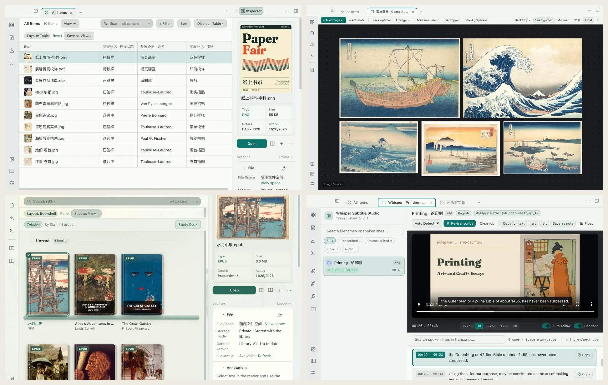
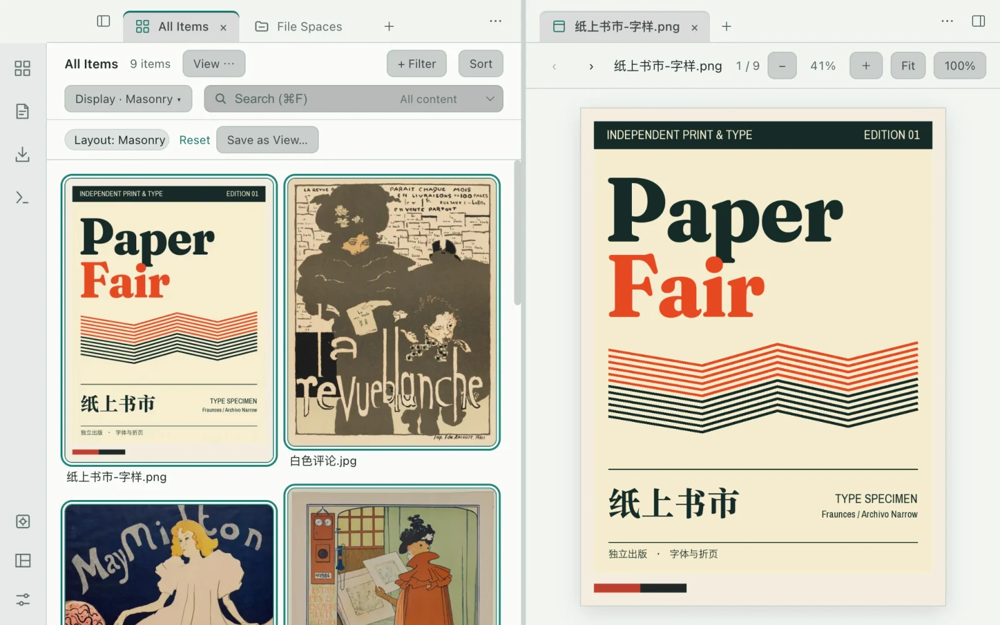
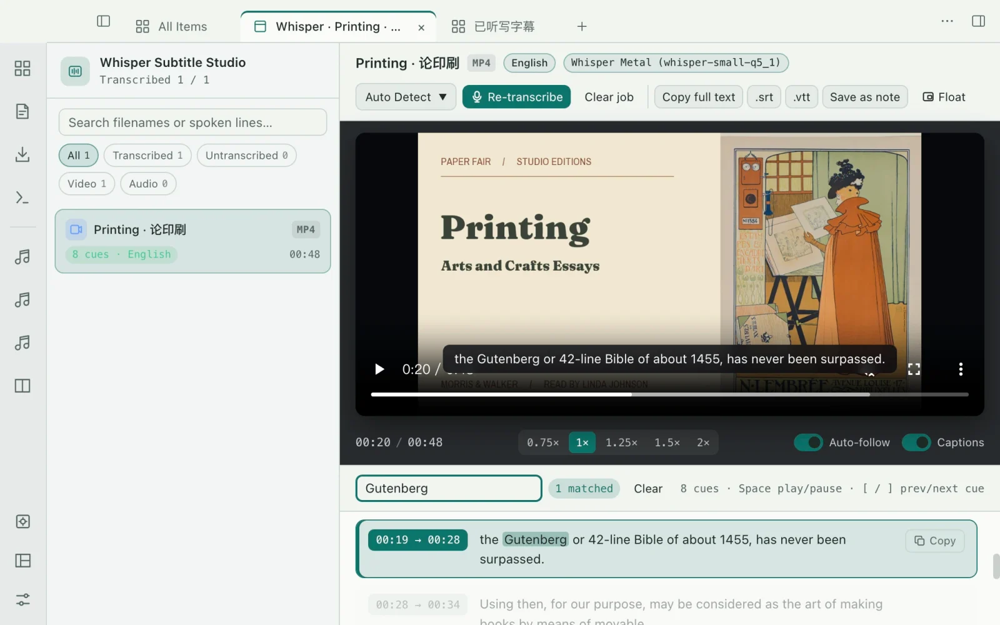
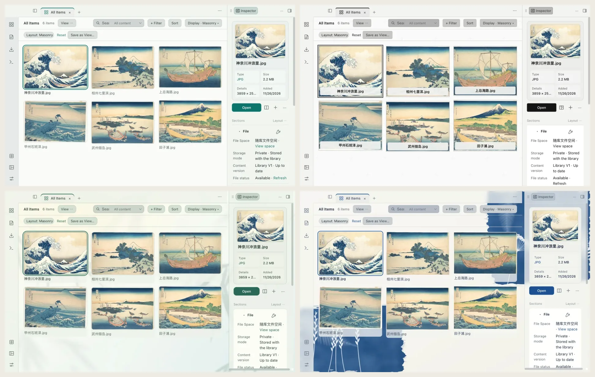
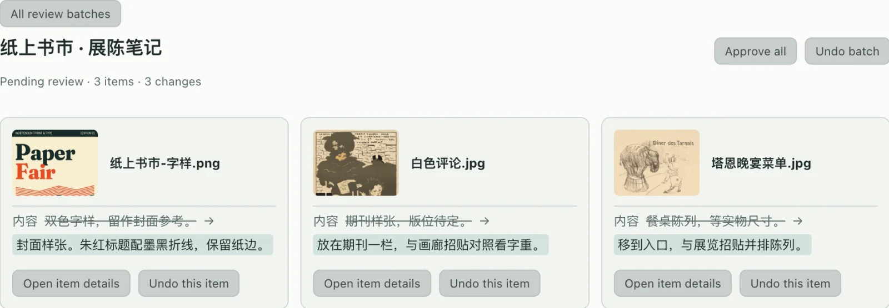

<div align="center">

<picture>
  <source media="(prefers-color-scheme: dark)" srcset="docs/assets/huoye-lockup-dark.svg" />
  <source media="(prefers-color-scheme: light)" srcset="docs/assets/huoye-lockup-light.svg" />
  
</picture>

**Separate files from views. Snap in any workspace.**

*原件与视角分开，形态由内页生长。*

[简体中文](README.md) | English · [Website huoye.org](https://huoye.org/en/) · [Catalog](https://huoye.org/en/catalog) · [Extensions Repo huoye-extensions](https://github.com/XinXingNOVA/huoye-extensions)

[](LICENSE)
[](#download--quick-start)
[](#download--quick-start)
[](#5-reversible-mcp-ai--100k-item-baseline)

[Workspaces](#one-core-eight-workspaces) · [Capabilities](#core-capabilities) · [Quick Start](#download--quick-start) · [Docs](#documentation) · [Credits](#credits)

</div>

---

<picture>
  <source media="(prefers-color-scheme: dark)" srcset="docs/assets/hero-workbenches-dark-en.webp" />
  <source media="(prefers-color-scheme: light)" srcset="docs/assets/hero-workbenches-light-en.webp" />
  
</picture>

<p align="center"><sub>One core, four clip-in workspaces: Document Desk · Reference Board · Celadon Study · Offline Transcription (adapts automatically to light/dark mode)</sub></p>

## Why Huoye

Most of us end up installing half a dozen separate desktop apps — one for reference images, another for ebooks, another for documents, tables, or media review. Underneath, they are all doing variations of the same thing: **attaching layered data, views, and local processing to files with stable identities**.

**Huoye** (活页, *loose-leaf binder*) is an open-source, local-first, pluggable workbench for your files. Clip pages in or lift them out as your work changes, while your originals and annotations stay safely on disk:

- **Files separate from views**: Mount existing folders in place with zero copies and zero hidden files, or move evolving assets into managed storage with version history. Each library is simply a lens over your files.
- **Workspaces grow from clip-in pages**: Data blocks, background processing, views, offline compute engines, and themes are all modular. Disabling or removing a plugin never erases what you wrote.
- **Open to people and AI alike**: Built-in MCP support shares the exact same validated entry points as the UI — off by default, scoped per library, and delivered as a reversible review sheet.

---

## One Core, Eight Workspaces

The core app ships light with two built-in starter suites (**Visual Library** and **Reference Library**, 12 core plugins) plus 7 lightweight optional plugins.

For full specialized desks, install curated packs from **[huoye-extensions](https://github.com/XinXingNOVA/huoye-extensions)** or browse the **[Web Catalog](https://huoye.org/en/catalog)** (8 suites, 2 offline shared runtimes, standalone themes, and 38 individual plugins):

| Suite | Focus | Platform | Highlights |
| :--- | :--- | :--- | :--- |
| **Atelier Studio** (`atelier-studio`) | Art / Photo / Review | Cross-platform | Seeded shuffle & color spectrum wall, darkroom loupe, synced 2–4 image wipe compare, histograms, EXIF & AI prompt search |
| **Visual Search & Vision** (`visual-search`) | Search / OCR / Cutout | Cross-platform | Offline reverse image search, bilingual text-to-image search, zero-ingest drag search, Live Text OCR & one-click transparent cutouts |
| **Design Studio** (`design-studio`) | Fonts / PSD / SVG / 3D | Cross-platform | Live type specimen wall & variable axes, local PSD/PSB layer tree, safe SVG recoloring, WebGL2 3D turntable & PureBoard |
| **Celadon Study** (`reading-library`) | Books / Comics / Highlights | Cross-platform | Spread reading for EPUB, Kindle, PDF, comics & TXT, tactile bookshelf, book ledger & highlights that jump back to source |
| **Screening & Transcript Studio** (`media-studio`) | Film / Vinyl / Subtitles / Cut | Cross-platform | Frame-by-frame review, embedded multilingual subtitles, Hi-Fi vinyl deck, offline Whisper transcription & lossless clip cutting |
| **Documents & Archives Studio** (`doc-studio`) | Office / PDF / Archives / Data | Cross-platform* | Offline Word/PPT/RTF reading & FTS, PDF surgery & watermarks, no-extract ZIP/TAR search & 100k-row CSV/XLSX tables |
| **Forge Studio** (`forge-studio`) | Convert / Sheets / Sprites | Cross-platform | Batch image/media transcoding, long-image stitching, darkroom contact sheets & PDF albums, grid slicing & sprite sheets (with direct-to-disk export) |
| **Vault Insight** (`vault-insight`) | Link Graph / Health Audit | Cross-platform | Interactive force-directed relation graph, orphan detection, treemap storage breakdown, exact duplicate cleanup & SQLite compaction |

<sub>* PDF Forge uses macOS PDFKit. Bilingual text-to-image search and offline speech transcription pair with the optional shared runtime packs.</sub>

---

## Core Capabilities

### 1. Dual File Spaces & ECS-Inspired Identity

Huoye separates **file identity** from **file path**: each item is a stable Entity, tags/notes/fields/palettes/subtitles attach as Components, and authoritative records (`library.db`) live apart from rebuildable derived caches (`derived.db`).

- **In-Place Folders (Zero Copy, Zero Intrusion)**: Point Huoye at folders you already have. Nothing is duplicated and zero hidden files are written into your directories. Same-volume renames and moves reconnect automatically, and `lib://` streams PDFs and media in place.
- **Managed Storage (v4 Version Vault)**: Bring evolving assets into managed storage whenever you want revision history. Edit a working copy in your external app, publish a new version, and let each library sharing the original choose when to adopt it.

### 2. Multi-View Workbenches, Split Layouts & Floating Windows

Keep one collection and grow the view you need — table, masonry, gallery, timeline, Kanban, or reference board. Nest split panes into saved presets, or tear a reference board, PDF, or drop box out as a frameless **always-on-top floating window** beside your drawing, layout, or 3D app.

<picture>
  <source media="(prefers-color-scheme: dark)" srcset="docs/assets/shot-split-dark-en.webp" />
  <source media="(prefers-color-scheme: light)" srcset="docs/assets/shot-split-light-en.webp" />
  
</picture>

### 3. Offline Compute Bus & Shared Runtimes (New in v0.3)

Reverse image search, natural-language text search, Live Text OCR, subject cutout, and speech transcription all plug into a **versioned Capability Bus**:

- **Install once, share across libraries**: Heavy native runners and quantized weights ship as standalone `.hyruntime` archives (`huoye-cn-clip`, `huoye-whisper`). Import once in **Settings → Compute Engines** to share across every library — zero Python setup, zero bloat if unused.
- **Hot-swappable providers**: Choose your preferred engine per library (e.g., Apple Vision, Chinese-CLIP, or pure-TS Classic for embeddings; Apple Vision or Tesseract for OCR).
- **Strictly offline**: Everything runs locally on your machine, with on-demand execution so importing media never saturates your GPU.

<picture>
  <source media="(prefers-color-scheme: dark)" srcset="docs/assets/shot-compute-dark-en.webp" />
  <source media="(prefers-color-scheme: light)" srcset="docs/assets/shot-compute-light-en.webp" />
  
</picture>

### 4. Per-Library Paper & Declarative `.hytheme` Packs

Ships with 4 built-in day/night themes (**Huoye Standard**, **Silver Gelatin**, **Celadon Study**, **Compact Desk**) plus 2 example packs (**Cyanotype** and **Ginkgo Autumn**) under `host/examples/themes/`. Tune paper, wallpaper, accent color, density, and corners independently per library — synced live to detached windows. `.hytheme` packs are purely declarative and require no code execution.

<picture>
  <source media="(prefers-color-scheme: dark)" srcset="docs/assets/shot-themes-dark-en.webp" />
  <source media="(prefers-color-scheme: light)" srcset="docs/assets/shot-themes-light-en.webp" />
  
</picture>

### 5. Reversible MCP AI & 100k-Item Baseline

- **AI proposes, you approve**: Connect Claude, Codex, Cursor, or any MCP client. Access starts off and is granted per library (`off / read / organize / admin`). Batch edits arrive as a side-by-side **review sheet** with per-item undo; irreversible file deletion is never exposed to MCP.

<picture>
  <source media="(prefers-color-scheme: dark)" srcset="docs/assets/shot-ai-review-dark-en.webp" />
  <source media="(prefers-color-scheme: light)" srcset="docs/assets/shot-ai-review-light-en.webp" />
  
</picture>

- **Verified 50k / 100k-item baseline** (Apple M5 · 16 GiB · macOS local SSD · 20 active plugins, unique-hash PNG corpus):

| Scenario | 50,000 items | 100,000 items |
| :--- | ---: | ---: |
| Click thumbnail to open details | 34 ms | 34 ms |
| Incremental scan with no changes | ~0.8 ms | ~0.8 ms |
| Dense masonry scroll frame time / dropped frames | 0.14 ms / 0.0% | 0.13 ms / 0.0% |
| Idle search to results (incl. debounce) | 333 ms | 456 ms |
| Background ingest of 50 images to thumbnails & palettes | 3.09 s | 4.93 s |
| Launch to first-screen thumbnails | 5.01 s | 7.13 s (median) |

---

## Download & Quick Start

### 1. Download the Core App

Grab installers and `SHA256SUMS.txt` from [GitHub Releases](https://github.com/XinXingNOVA/huoye/releases) or [huoye.org/en/download](https://huoye.org/en/download):

- **macOS (Apple Silicon)**: Open the `.dmg` and drag Huoye into Applications (or extract the `.zip`). Because Huoye is an independent open-source project without Apple notarization yet, after verifying SHA-256 you can allow first launch with:
  ```bash
  xattr -dr com.apple.quarantine "/Applications/活页Huoye.app"
  ```
- **Windows (x64)**: Published on Releases alongside on-device verification (see [Platform Notes](docs/guide/platform-notes.md)).

### 2. Add Official Extensions

Download curated `.hysuite` suites, `.hyruntime` offline runtimes, `.hytheme` themes, and `.hyplugin` packages from **[huoye-extensions](https://github.com/XinXingNOVA/huoye-extensions/releases)** or the **[Web Catalog](https://huoye.org/en/catalog)**, then drop them into Huoye Settings.

### 3. Build from Source (Node.js 24+)

```bash
git clone https://github.com/XinXingNOVA/huoye.git
cd huoye/host
npm ci
npm run build
npm start
```

---

## Documentation

- **Guides** *(Simplified Chinese)*: [Quick Start](docs/guide/quick-start.md) · [Plugins & Suites](docs/guide/plugins-and-suites.md) · [Offline Compute & Runtimes](docs/guide/compute-and-runtimes.md) · [Themes & Appearance](docs/guide/themes-and-appearance.md) · [AI & MCP](docs/guide/ai-mcp.md) · [Platform & Backup](docs/guide/platform-notes.md)
- **Architecture & Releases**: [Design Philosophy](host/docs/architecture/设计理念.md) · [System Architecture](host/docs/architecture/设计文档.md) · [Performance Baseline](host/docs/development/performance/README.md) · [v0.3.0 Release Notes](RELEASE-NOTES-v0.3.0.md)
- **Building Extensions**: [Write Your First Plugin](docs/developer/first-plugin.md) · [AI Index (`llms.txt`)](llms.txt) · [Public API Overview](host/docs/plugins/公共API总览.md) · [UI Kit Reference](host/docs/plugins/UI-Kit.md) · [`.hytheme` Spec](host/examples/themes/README.md)

---

## Boundaries & Roadmap

- **Local-first, no built-in cloud sync**: All databases and local catalogs stay on your machine. See [Platform & Backup](docs/guide/platform-notes.md) for backup guidance.
- **Trusted local extension model**: `.hytheme` packs are purely declarative; `.hyplugin`, `.hysuite`, and `.hyruntime` packages are not sandboxed against malicious code — install only from trusted sources.
- **Planned (v0.4 direction)**: Exploring an in-app AI workbench built around floating side-by-side chat, reusable cross-plugin workflow recipes, optional local-only models, and the same rule: AI proposes, you approve.

---

## License & Credits

- Source code is licensed under [Apache-2.0](LICENSE). Third-party notices live in [THIRD-PARTY-NOTICES.md](THIRD-PARTY-NOTICES.md).
- **Brand notice**: The **Huoye / 活页** name and mark belong to the author; forks and redistributions should use a distinct name and icon.

Built during my senior year in close collaboration with AI — special thanks to **[Zhangjingzhi](https://github.com/zhangjingzhi623)** for generously supporting the AI memberships that made this exploration possible.
