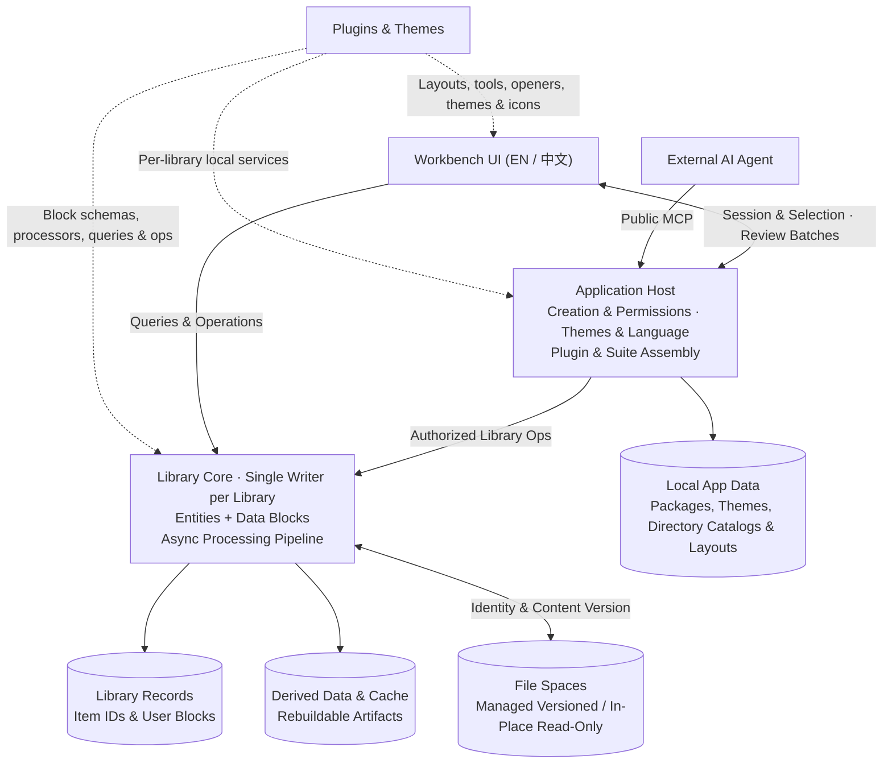
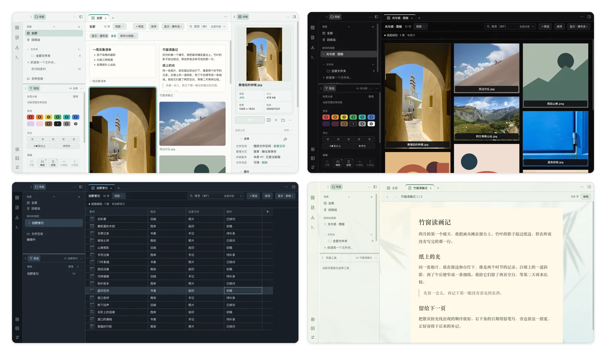
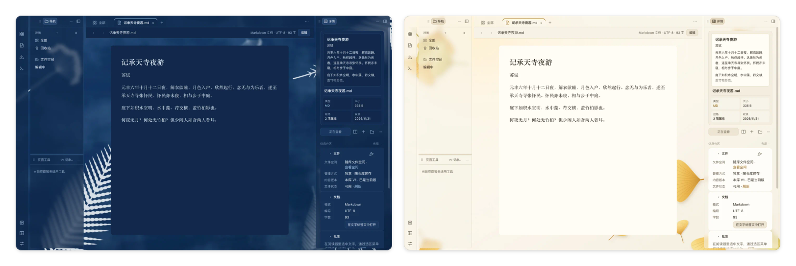

<div align="center">

<picture>
  <source media="(prefers-color-scheme: dark)" srcset="docs/assets/huoye-lockup-dark.svg" />
  <source media="(prefers-color-scheme: light)" srcset="docs/assets/huoye-lockup-light.svg" />
  
</picture>

**An open, plugin-driven, AI-native loose-leaf workbench for local files, media, and knowledge.**

[简体中文](README.md) | English

[](LICENSE)
[](#quick-start)
[](#quick-start)
[](#5-bilingual-ui--100k-item-benchmarks)

[Quick Start](#quick-start) · [Core Features](#core-features) · [AI Collaboration](#4-native-ai-collaboration-mcp) · [Documentation](#documentation) · [Credits](#credits)

</div>

---


## Why Huoye?

Most of us juggle separate desktop apps for images, PDFs, ebooks, notes, audio, and structured tables. Underneath those different surfaces, however, they all share the same core pattern: **stable item identities layered with composable data blocks and interchangeable views**.

**Huoye** (Chinese: 活页, *loose-leaf binder*) is an open, local-first workbench built around that idea:

- **Originals decoupled from views**: Keep files inside a versioned **Managed Space**, or link an existing **In-Place Folder** on disk without copying a single byte. Each **Library** is simply your own lens of tags, notes, fields, and saved views over those files.
- **Shape grows from plugins & themes**: Data blocks, background processors, browsing layouts, and visual aesthetics are all pluggable. Disabling or uninstalling a plugin never deletes your underlying records, and every library can wear its own theme and atmosphere.
- **AI-native from day one**: Instead of bolting a chat sidebar on top, Huoye exposes an application-level **MCP (Model Context Protocol)** server sharing the exact same commands, validation, and permission boundaries as the UI—complete with reviewable, undoable **Review Batches**.

Swap plugins, suites, and themes, and the same base transforms into an Eagle-style visual reference library, a structured table workspace, an ebook/PDF study, or your personal local AI workbench.

---

## One Base, Many Forms

The bundled and optional plugins support English and Simplified Chinese.

| Form | Availability | Capabilities |
| --- | --- | --- |
| **Visual Library** | Bundled starter preset | Folders, tags & tag groups, 1–5 star ratings, aspect/size filters, automatic color palettes & color-family search, notes, sources, masonry grid & inspector (recommends *Silver Gelatin* theme) |
| **Reference Library** | Bundled starter preset | PDF / Markdown / text / source management, excerpts & annotations, custom field templates, inline table editing, controlled external file editing (recommends *Compact Desk* theme) |
| **7 Optional Extensions** | Optional `.hyplugin` bundle | EPUB Reader (theme-aware typography), Music Player, Hierarchical Tag Tree, Gallery, Timeline, Status, and Kanban board |
| **Zero-Copy In-Place Folders** | New in v0.2 | Start directly from an existing folder of photos, PDFs, or notes without duplicating files; tracks moves/renames and lets you preview & accept external edits |
| **Day/Night Themes & Per-Library Styling** | New in v0.2 | 4 featured day/night built-in themes with live previews (plus 7 classic themes) + declarative `.hytheme` packages (wallpapers & tiled textures, corner stickers, glassmorphism, 32 custom SVG icons) |


---

## Core Features

### 1. ECS-Inspired Open Base & Three-Layer Plugin Architecture

Inspired by ECS (Entity–Component–System): every item has a stable identity (Entity) independent of filenames or disk paths; tags, notes, fields, and palettes attach as data blocks (Components); background processors (Systems) compute rebuildable thumbnails, palettes, and text indices asynchronously.

A single plugin can extend the **Library Core** (`blocks.ts` / `core.ts`), **Workbench UI** (`ui.tsx` with shared `UI Kit` and `ui-locale-v1` dictionaries), and **Local Services** (`service.ts`). User records (`library.db`) and rebuildable caches (`derived.db`) stay strictly separated so disabling a plugin preserves your data.



### 2. Dual-Mode File Spaces: Managed Vaults & Zero-Copy In-Place Folders

- **Managed Spaces (v4)**: Immutable content version history, multi-library sharing with independent version adoption, controlled external editing via managed working copies, and clean separation between library trash, space recycle bin, and system trash.
- **In-Place Folders (New in v0.2)**:
  - Click **Start from a Folder…** on the Launcher to organize an existing folder of photos, ebooks, or papers **without copying files** and **without writing hidden files into your folder** (catalogs live in Huoye's local app data);
  - Automatically preserves item identities across same-volume renames and moves, supports root relocation and offline-drive protection, and streams originals natively via `lib://` with HTTP `Range` support (PDF & media seeking);
  - After saving changes in an external editor, open the item to check and accept the new version. Tags and notes stay with the item. If the editor overwrote the old file, Huoye retains its recorded size and hash. For retrievable version history, create a managed copy before editing it.
  - Inspect all library references per File Space and safely trash confirmed-missing primary items after verified disk checks.

### 3. Customizable Aesthetics & `.hytheme` Ecosystem (New in v0.2)

- **4 Featured Day/Night Themes & Per-Library Styling**: Ships with **Huoye Standard** (new-install default), **Silver Gelatin** (recommended for Visual Library—editorial proof sheet & darkroom frames), **Celadon Study** (bamboo-shadow margins & serif long-form reading), and **Compact Desk** (recommended for Reference Library), all supporting automatic OS day/night sync (with 7 classic palettes tucked cleanly under *Classic themes*). Detached content windows and settings windows automatically inherit their library's theme, decorations, and icons.
- **Declarative `.hytheme` Packages (v1–v6)**: Zero code execution. Supports **paired light/dark day–night variants** (following OS appearance or pinned per library), live preview thumbnails, unified Text/PDF/EPUB reading typography & paper tones, and **32 sanitized geometric SVG icon overrides**.
- **Wallpapers, Stickers & Glassmorphism**: Pick a local image or right-click any library image to set it as that library's wallpaper; configure cover vs. tiled textures, 9-point anchor, 4-corner auto-dodging stickers (scale & opacity), and translucent frosted panels—with per-card blur kept opt-in based on 100k-item scroll benchmarks.
- **Intent-Driven Appearance Settings**: Application defaults, per-library appearance, and plugin-contributed appearance controls (such as PDF default paper mode) live cleanly together.



<p align="center"><sub>Four built-in day/night themes · Top-left: Huoye Standard (Light) · Top-right: Silver Gelatin (Dark) · Bottom-left: Compact Desk (Dark) · Bottom-right: Celadon Study (Light)</sub></p>



<p align="center"><sub>Bundled installable <code>.hytheme</code> packages · Left: Cyanotype (Dark) · Right: Ginkgo (Light) — both support paired day/night switching, atmospheric wallpapers, and reading typography</sub></p>

### 4. Native AI Collaboration (MCP)

Huoye ships an application-level **MCP** server where AI clients (Claude Code, Cursor, Codex, etc.) use the exact same core commands and guards as the desktop UI:

- **Per-Library Explicit Permissions**: `off / read / organize / admin` (all existing libraries default to `off`). Permanent file destruction is never exposed to MCP.
- **L0–L2 Collaboration Levels**:
  - **L0 Autonomous Library Creation**: Create libraries from approved starter presets in permitted parent folders, configure views and split panes, and present the finished workspace.
  - **L1 Read & Organize**: Inspect schemas, read text and up to 12-item numbered contact-sheet previews, check in-place folders, wait for background processing, and write tags/ratings/fields.
  - **L2 Co-Pilot & Review Batches**: Read the active view and selection, highlight results, and push a persistent **Review Batch** showing before/after diffs with per-item undo.
- **Autonomous Plugin Development**: Coding agents can scaffold isolated plugin projects, build, load into a test library, and verify end-to-end via MCP.


### 5. Bilingual UI & 100k-Item Benchmarks

- **Switch languages without restarting**. Choose Follow System, 简体中文, or English. The launcher, workbench, settings, native menus, and detached windows update immediately. Both starter suites and the 19 release plugins (12 bundled and 7 optional) provide bilingual dictionaries. Your item names, tags, and saved views keep their original wording.
- **Real-World Large-Library Benchmarks** (Apple M5 · 16 GiB · macOS · local SSD · 20 active plugins · unique-hash PNG corpus):

| Operation | 50,000 Items | 100,000 Items |
| --- | ---: | ---: |
| Cold launch to first visible thumbnails | 5.01 s | 7.83 s (retest median 7.13 s) |
| Idle search input to results (incl. debounce) | 333 ms | 456 ms |
| Click thumbnail to inspector details | 34 ms | 34 ms |
| Background ingest of 50 new images (thumbnails + palettes ready) | 3.09 s | 4.93 s |
| No-change incremental scan verification | ~0.8 ms | ~0.8 ms |
| Dense masonry (120 px cards) workbench-glass scroll median draw / checkerboarded frames | 0.14 ms / 0.0% | 0.13 ms / 0.0% |

> Full methodology and per-card blur comparisons: [Performance Baselines](host/docs/development/performance/README.md) · [Masonry Glassmorphism Benchmark](host/docs/development/performance/2026-11-21/卡片毛玻璃.md).

---

## Quick Start

### Option 1: Download Prebuilt App (macOS Apple Silicon)

The macOS build runs on Apple Silicon. Downloads are on [GitHub Releases](https://github.com/XinXingNOVA/huoye/releases/tag/v0.2.0). The Windows build is awaiting on-device verification.

1. **Main App (Batteries Included)**:
   - Open the [DMG installer](https://github.com/XinXingNOVA/huoye/releases/download/v0.2.0/Huoye-0.2.0-mac-arm64.dmg) and drag Huoye into Applications, or extract the [macOS app ZIP](https://github.com/XinXingNOVA/huoye/releases/download/v0.2.0/Huoye-0.2.0-mac-arm64.zip) for the same app. Verify your download against [SHA256SUMS.txt](https://github.com/XinXingNOVA/huoye/releases/download/v0.2.0/SHA256SUMS.txt) on the release page.
   - Click **Create** to start with *Visual Library*, *Reference Library*, or *Blank Library*—or click **Start from a Folder…** to mount an existing folder in place.
   - Switch UI language anytime under **Settings → Language / 界面语言** (follows your OS language by default).
2. **Optional plugin bundle**
   - The separate [Huoye-0.2.0-plugins.zip](https://github.com/XinXingNOVA/huoye/releases/download/v0.2.0/Huoye-0.2.0-plugins.zip) bundle is for EPUB Reader, Music Player, Hierarchical Tag Tree, Gallery, Timeline, Status, and Kanban.
   - Unzip, open **Settings → Suites & Plugins → Install Suites or Plugins…** (multi-select supported), then enable them per library under **Features & Presets**.
3. **Curated `.hytheme` Packages**:
   - Two paired day/night `.hytheme` packages are included under `host/examples/themes/` in the source tree: **[cyanotype.hytheme](https://raw.githubusercontent.com/XinXingNOVA/huoye/v0.2.0/host/examples/themes/cyanotype.hytheme) (Cyanotype)** and **[ginkgo.hytheme](https://raw.githubusercontent.com/XinXingNOVA/huoye/v0.2.0/host/examples/themes/ginkgo.hytheme) (Ginkgo)**. Under **Settings → Appearance & Themes → Install Theme…**, install a file and then select its card under **Installed themes** to apply it.

> **macOS First Launch Note**: This open-source preview uses ad-hoc signing (not notarized with an Apple Developer ID). After verifying the checksum from an official release, remove the quarantine attribute if macOS blocks launch:
> ```bash
> xattr -dr com.apple.quarantine "/Applications/活页Huoye.app"
> ```

### Option 2: Build from Source

Run these commands from the root of a source checkout or extracted snapshot. Download the source snapshot from [Huoye-0.2.0-source.zip](https://github.com/XinXingNOVA/huoye/releases/download/v0.2.0/Huoye-0.2.0-source.zip). You need **Node.js 24+**, npm, and native module build tools.

```bash
cd host
npm ci
npm run build
npm start
```

Development runs against an isolated user-data directory so your daily libraries stay untouched.

---

## Documentation

*(Guides are currently maintained in Simplified Chinese alongside the bilingual UI and English developer references.)*

- **User Guides**: [5-Minute Quick Start](docs/guide/quick-start.md) · [Themes & Appearance Guide](docs/guide/themes-and-appearance.md) · [AI & MCP Guide](docs/guide/ai-mcp.md) · [Plugins & Suites](docs/guide/plugins-and-suites.md) · [Platform & Backup Notes](docs/guide/platform-notes.md)
- **Developer & AI Index**: [Build Your First Plugin](docs/developer/first-plugin.md) · [UI Kit Reference](host/docs/plugins/UI-Kit.md) · [`.hytheme` Spec](host/examples/themes/README.md) · [AI Documentation Index (`llms.txt`)](llms.txt)

---

## Current Boundaries & Roadmap

- **Local storage and backups**. Back up the library and each linked managed space. For an in-place folder, also keep the original files and Huoye’s local `file-spaces/` catalogs, which connect those files to library items. [Backup instructions (Chinese)](docs/guide/platform-notes.md)
- **Trusted local plugins**: `.hytheme` packages are strictly declarative (no code execution), while `.hyplugin` / `.hysuite` packages run trusted code without a malicious-code sandbox—only install packages from trusted sources.
- **No online store or auto-updater yet**: Distributed via GitHub Releases.

**Roadmap:**
- [x] Customizable themes, day/night OS sync, wallpapers/stickers, and `.hytheme` ecosystem
- [x] Shared `UI Kit` primitives & SVG icon system for plugins
- [x] Zero-copy In-Place Folder File Spaces with identity tracking and update adoption
- [x] Language switching in the launcher, workbench, settings, and release plugins
- [ ] Migrate and ship reading-embedded `ai-chat` and new turnkey suites (Study & Ebook Library, Music & Focus Space, etc.)
- [ ] Complete Windows on-device installer & media verification
- [ ] Expand plugin/theme starter templates and additional community languages

---

## License & Brand

- Source code is licensed under [Apache License 2.0](LICENSE).
- Third-party notices and native dependency disclosures are listed in [THIRD-PARTY-NOTICES.md](THIRD-PARTY-NOTICES.md).
- **Brand Notice**: While the code is Apache-2.0, the **Huoye / 活页** name and logo belong to the project author; please use a distinct name and icon for derivative distributions.

---

## Credits

Built over a month of deep human–AI collaboration during my senior year of college.

- **Special Thanks**: Heartfelt thanks to **[Zhangjingzhi](https://github.com/zhangjingzhi623)** for generously sponsoring the AI subscriptions that made this exploration possible.
- **Collaboration**:
  - **Product Direction, Architecture & UX Decisions**: Author
  - **Design & Architectural Planning**: Author · Gemini · GPT
  - **Implementation & Refactoring**: GPT
  - **Logo, Visual Exploration & Theme Design**: Author · Gemini · Claude

Issues, ideas, plugins, and custom `.hytheme` contributions are warmly welcome!
