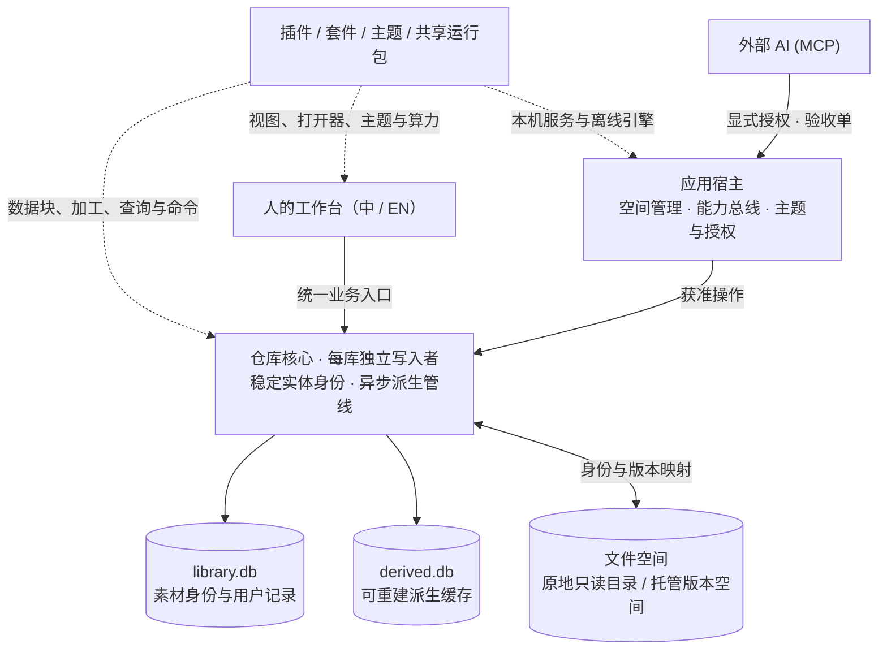
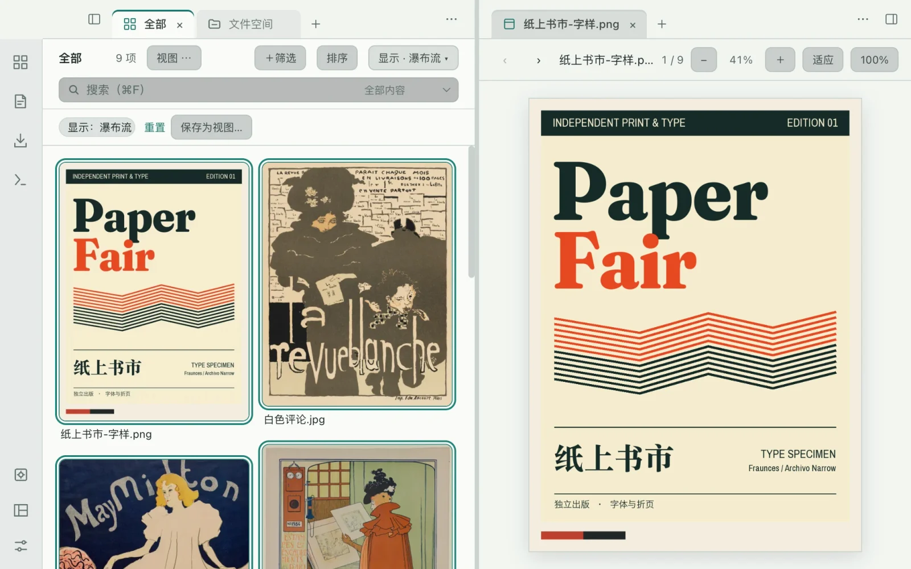
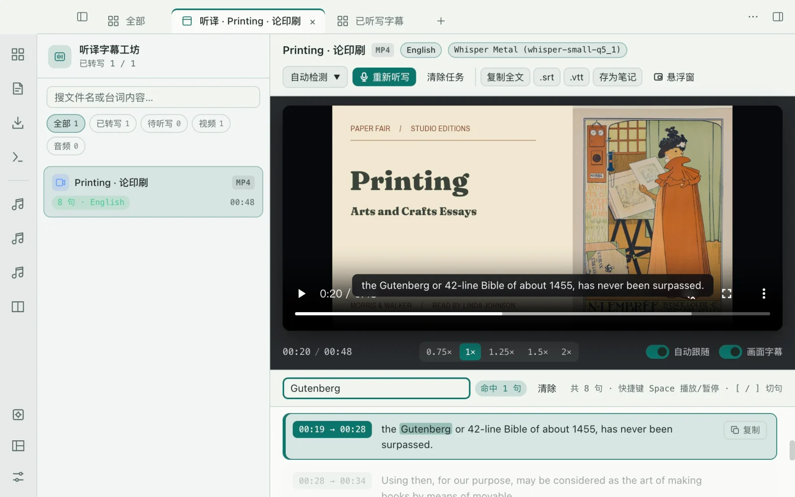
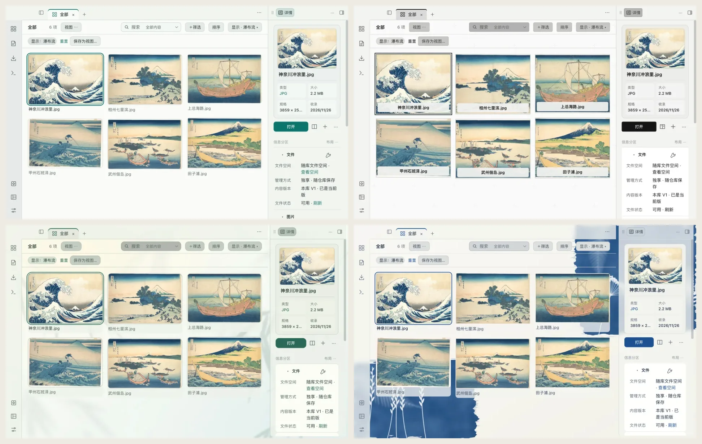

<div align="center">

<picture>
  <source media="(prefers-color-scheme: dark)" srcset="docs/assets/huoye-lockup-dark.svg" />
  <source media="(prefers-color-scheme: light)" srcset="docs/assets/huoye-lockup-light.svg" />
  
</picture>

**原件与视角分开，形态由内页生长。**

*Separate files from views. Snap in any workspace.*

简体中文 | [English](README.en.md) · [官方网站 huoye.org](https://huoye.org) · [扩展馆 Catalog](https://huoye.org/catalog) · [官方扩展仓 huoye-extensions](https://github.com/XinXingNOVA/huoye-extensions)

[](LICENSE)
[](#下载与快速开始)
[](#下载与快速开始)
[](#5-双语界面与十万项实测性能)

[一底多形](#一底多形从文件夹到八种工作台) · [核心能力](#核心能力) · [下载与快速开始](#下载与快速开始) · [文档导航](#文档导航) · [致谢](#致谢与协作说明)

</div>

---

<picture>
  <source media="(prefers-color-scheme: dark)" srcset="docs/assets/hero-workbenches-dark-zh.webp" />
  <source media="(prefers-color-scheme: light)" srcset="docs/assets/hero-workbenches-light-zh.webp" />
  
</picture>

<p align="center"><sub>同一套底座装上不同内页：文档表格台 · 海岸画室参考板 · 青瓷书房 · 离线影音听译（随系统明暗自动切换）</sub></p>

## 为什么做「活页」

我一直对“通用性”很感兴趣，顺着这个念头，走进了文件与资料管理的领域。

平时我们常常要装上好几款软件，分别管图片、看电子书、理文档、听音频、记笔记。顺着本质往下看，这些形态各异的工具其实都围绕同一件事——**在稳定的素材身份之上，一层层按需叠加的数据、视图与算力**。

**活页（Huoye）** 是一座开源、本地优先、功能皆可插拔的文件与资源底座。像活页环一样，你可以随时装上或取下不同的内页，而真正属于你的原件与积累永远留在本地：

- **原件与视角分开**：既可以零复制挂载你硬盘上已有的文件夹，也可以把需要修订历史的资产放进带版本记录的托管空间；一个个仓库，只是你观察和整理同一批资料的不同侧面。
- **形态由内页生长**：数据结构、后台加工、浏览视图、本地算力引擎与纸墨主题全部可扩展；停用或卸载插件，你写下的标签、笔记和字段依然留在库里。
- **对人与 AI 同等开放**：内置应用级 MCP 入口，AI 与人共用同一套业务命令与校验边界——默认关闭、按库分级授权，改完交一张逐项可撤回的验收单。

---

## 一底多形：从文件夹到八种工作台

主程序保持轻量，开箱内置两套起始方案（**视觉素材库** / **通用资料与表格库**）及 12 个基础插件，并提供 7 个轻量可选包。

如果你需要完整垂直场景，可直接从官方扩展仓库 **[huoye-extensions](https://github.com/XinXingNOVA/huoye-extensions)**（或 [官网扩展馆](https://huoye.org/catalog)）获取 8 套场景套件、2 个离线共享运行包、独立主题与 38 个单装插件：

| 套件 | 适用场景 | 平台 | 核心能力 |
| :--- | :--- | :--- | :--- |
| **画室精审** (`atelier-studio`) | 画师 / 摄影 / 美术 | 全平台 | 随机洗牌与色彩光谱漫游、暗房级逐像素精审、2–4 图同步卷帘对比、直方图与 AI 生成参数检索 |
| **灵图与灵眸** (`visual-search`) | 搜图 / OCR / 抠图 | 全平台 | 离线以图搜图、中英文自然语言文搜图、外图拖入直搜、实况文本 OCR 与一键透明主体抠图 |
| **设计工坊** (`design-studio`) | 字体 / PSD / SVG / 3D | 全平台 | 字体试打墙与可变轴、免 Photoshop 读 PSD/PSB 图层、SVG 调色检视、WebGL2 3D 展台与参考板 |
| **青瓷书房** (`reading-library`) | 电子书 / 漫画 / 书摘 | 全平台 | EPUB / Kindle / PDF / 漫画 / 长篇 TXT 双页精读、青瓷书架、书目台账与书摘一键跳回原文 |
| **黑胶放映与听译** (`media-studio`) | 拉片 / 黑胶 / 听译 / 快剪 | 全平台 | 逐帧拉片与内封多语字幕、黑胶真波形播放、本地 Whisper 离线转字幕、自动分镜与无损快剪 |
| **办公与档案工坊** (`doc-studio`) | Office / PDF / 压缩包 / 表格 | 全平台* | 离线读 Word / PPT / RTF 与全文检索、PDF 合并拆分水印、ZIP/TAR 免解压直搜、十万行 CSV/XLSX 表格 |
| **效率魔方** (`forge-studio`) | 批转 / 联系表 / 切图 | 全平台 | 图片与音视频批量转换压制、长图拼接、暗房联系表与 PDF 画册、九宫格切图与精灵图合图（支持不入库直出） |
| **仓库洞察** (`vault-insight`) | 关系星图 / 空间体检 | 全平台 | 交互式资产关系星图、孤岛素材检出、空间占用矩形树图、精确重复文件排查与数据库压缩 |

<sub>* 注：办公与档案工坊中的 PDF 手术台（`pdf-forge`）依赖 macOS 原生 PDFKit；中英文文搜图与离线语音听译分别搭配官方共享运行包使用。</sub>

---

## 核心能力

### 1. 双模式文件空间与 ECS 稳定身份

借鉴 ECS（实体-组件-系统）的职责划分：每份素材拥有独立于磁盘路径的稳定身份（Entity），标签、笔记、字段、色板、字幕像活页一样按需挂载（Component），原始记录（`library.db`）与可重建派生缓存（`derived.db`）严格分离。

- **原地目录空间（零复制、零侵入）**：从开始页直接挂载硬盘上已有目录，不复制原件、不往你的文件夹里写任何隐藏文件。同卷改名或跨目录移动可刷新/核对并接续原素材与笔记，支持 `lib://` 流式读取。
- **托管版本空间（v4 保险箱）**：需要反复改稿与历史版本时，随时将选中文件转入托管空间。通过受控工作副本在外部编辑器修改，发布新版本后，共用原件的多个仓库各自决定何时接纳。



### 2. 多视图、自由分屏与可撕出的置顶小窗

同一份清单，装上看板就能按状态推进度，装上参考板就能铺开选图；主工作台支持任意嵌套分屏与按任务保存的布局预设。参考板、PDF 或收纳盒还能撕成无框**置顶小窗**，浮在绘图、排版或 3D 软件旁边协同工作。

<picture>
  <source media="(prefers-color-scheme: dark)" srcset="docs/assets/shot-split-dark-zh.webp" />
  <source media="(prefers-color-scheme: light)" srcset="docs/assets/shot-split-light-zh.webp" />
  
</picture>

### 3. 本地离线算力总线与共享运行包（v0.3 新增）

以图搜图、自然语言文搜图、实况 OCR、主体抠图与语音听译全部通过**版本化能力契约（Capability Bus）**解耦：

- **按需装入、多库共享**：将体积较大的原生推理程序与量化模型打包为 `.hyruntime` 共享运行包（如 `huoye-cn-clip`、`huoye-whisper`）。在「设置 → 计算引擎」导入一次，多个仓库共用；不装不占主程序体积，无需配置 Python 环境。
- **同一接口自由换引擎**：可按仓库自由切换底层提供方（例如视觉特征在 Apple Vision / Chinese-CLIP / 跨平台经典引擎之间切换，OCR 在 Apple Vision / Tesseract 之间切换），不被单一引擎锁死。
- **数据不出本机**：推理全部在本地完成，支持按需触发（如导入音视频不自动占满 GPU）。

<picture>
  <source media="(prefers-color-scheme: dark)" srcset="docs/assets/shot-compute-dark-zh.webp" />
  <source media="(prefers-color-scheme: light)" srcset="docs/assets/shot-compute-light-zh.webp" />
  
</picture>

### 4. 一库一纸：昼夜双模与 `.hytheme` 主题体系

开箱内置 4 套昼夜主题（**活页·标准**、**银盐画册**、**青瓷书房**、**紧凑资料台**），并在主仓 `host/examples/themes/` 随附 **蓝晒** 与 **银杏·秋光** 两套示例主题包。每个仓库可独立选择纸张主题、壁纸纹理、强调色、密度与圆角，独立小窗自动同步；`.hytheme` 为纯声明式主题包，无需执行权限。

<picture>
  <source media="(prefers-color-scheme: dark)" srcset="docs/assets/shot-themes-dark-zh.webp" />
  <source media="(prefers-color-scheme: light)" srcset="docs/assets/shot-themes-light-zh.webp" />
  
</picture>

### 5. 可控的 MCP AI 协作与十万项实测性能

- **AI 进来干活，由人拍板**：外部客户端（Claude / Codex / Cursor 等）通过 MCP 接入。授权默认关闭，按仓库独立设置 `off / read / organize / admin` 四档；批量整理会生成带修改前后对照的**批次验收单**，支持逐项撤回，不可逆清除操作不向 MCP 开放。

<picture>
  <source media="(prefers-color-scheme: dark)" srcset="docs/assets/shot-ai-review-dark-zh.webp" />
  <source media="(prefers-color-scheme: light)" srcset="docs/assets/shot-ai-review-light-zh.webp" />
  
</picture>

- **中英双语热切换**：设置中免重启切换跟随系统 / 简体中文 / English，用户数据保留原文。
- **5 万 / 10 万项实测性能基线**（Apple M5 · 16 GiB · macOS 本机磁盘 · 同时启用 20 个插件、独立哈希 PNG 存量库）：

| 操作场景 | 5 万项规模 | 10 万项规模 |
| :--- | ---: | ---: |
| 点击缩略图到显示详情 | 34 ms | 34 ms |
| 无变化增量扫描核对 | ~0.8 ms | ~0.8 ms |
| 密集瀑布流工作台毛玻璃滚动帧时 / 掉帧率 | 0.14 ms / 0.0% | 0.13 ms / 0.0% |
| 空闲输入搜索到结果（含防抖） | 333 ms | 456 ms |
| 后台收录 50 张至缩略图与色板就绪 | 3.09 s | 4.93 s |
| 启动到首屏缩略图可见 | 5.01 s | 7.13 s（复测中位数） |

> 完整测试口径与复测命令见 [大库性能基线](host/docs/development/performance/README.md)。

---

## 下载与快速开始

### 1. 下载活页主程序

前往 [GitHub Releases](https://github.com/XinXingNOVA/huoye/releases) 或 [huoye.org/download](https://huoye.org/download) 下载安装包，并用同页 `SHA256SUMS.txt` 核对校验和：

- **macOS（Apple Silicon）**：下载 `.dmg`（拖入「应用程序」）或 `.zip`。个人开源项目暂未购买 Apple 公证证书，首次打开若提示无法验证开发者，核对校验和后可在终端执行：
  ```bash
  xattr -dr com.apple.quarantine "/Applications/活页Huoye.app"
  ```
- **Windows（x64）**：随实机验收同步发布于 Releases（当前安装注意项见 [平台说明](docs/guide/platform-notes.md)）。
- **主仓内置与可选包**：主程序已内置两套起始方案（12 个基础插件）；另有 7 个基础可选插件合集及 2 套示例主题（`host/examples/themes/cyanotype.hytheme`、`ginkgo.hytheme`）。

### 2. 安装官方扩展（`.hysuite` / `.hyruntime` / `.hytheme` / `.hyplugin`）

前往 **[huoye-extensions Releases](https://github.com/XinXingNOVA/huoye-extensions/releases)** 或 **[官网扩展馆](https://huoye.org/catalog)** 获取 8 套场景套件、2 个离线共享运行包、独立主题与 38 个单装插件：
- **套件与插件**：在「设置 → 套件与插件包」拖入 `.hysuite` 或 `.hyplugin` 安装；
- **共享运行包**：在「设置 → 计算引擎 → 共享运行包」导入 `.hyruntime` 启用；
- **主题包**：在「设置 → 外观与主题」导入 `.hytheme` 启用。

### 3. 从源码构建（需要 Node.js 24+）

```bash
git clone https://github.com/XinXingNOVA/huoye.git
cd huoye/host
npm ci
npm run build
npm start
```

开发与预览默认使用独立的用户数据目录，不会影响正式仓库。更多构建与测试细节见 [开发与验证](host/docs/development/开发与验证.md) 与 [Windows 构建指南](host/docs/development/Windows-AI构建指南.md)。

---

## 文档导航

- **使用指南**
  - [5 分钟上手活页](docs/guide/quick-start.md)：建库、零复制挂载文件夹、视图分屏、置顶小窗与安全编辑
  - [插件、套件与一软多库玩法](docs/guide/plugins-and-suites.md)：4 种产物安装、主仓内置与 `huoye-extensions` 搭配、停用与清理
  - [本地离线算力与共享运行包](docs/guide/compute-and-runtimes.md)：能力总线、`.hyruntime` 导入、按库切换引擎与平台说明
  - [外观、主题与壁纸定制指南](docs/guide/themes-and-appearance.md)：一库一风、昼夜切换、壁纸贴纸与 `.hytheme`
  - [接上你的 AI 搭档（MCP 实战指南）](docs/guide/ai-mcp.md)：四档授权、原地目录整理与批次验收单
  - [平台说明与备份建议](docs/guide/platform-notes.md)：macOS / Windows 安装提示、FFmpeg 与完整备份方案
- **架构与发布**
  - [设计理念](host/docs/architecture/设计理念.md) · [系统架构](host/docs/architecture/设计文档.md) · [文件空间契约](host/docs/architecture/文件空间.md) · [v0.3.0 更新说明](RELEASE-NOTES-v0.3.0.md)
- **外部插件与主题开发**
  - [10 分钟写出第一个活页插件](docs/developer/first-plugin.md)：克隆主仓 → 阅读 `llms.txt` → 独立外部目录开发、`check` 与 `pack`
  - [AI 文档索引（llms.txt）](llms.txt) · [公共 API 总览](host/docs/plugins/公共API总览.md) · [UI Kit 速查](host/docs/plugins/UI-Kit.md) · [`.hytheme` 主题包规范](host/examples/themes/README.md)

---

## 当前边界与后续方向

- **本地优先，暂无内置云同步**：全部记录与缓存保存在本机，备份时需连同仓库、文件空间与原地登记簿一并留存（见 [备份建议](docs/guide/platform-notes.md)）。
- **可信本地插件体系**：`.hytheme` 为纯声明式零执行权限；`.hyplugin` / `.hysuite` / `.hyruntime` 当前不做恶意代码沙箱，请只安装信任来源的包。
- **规划中（v0.4 方向）**：在保持克制与可控边界的前提下，探索内嵌于活页的 AI 协作工作台——支持置顶小窗边看边聊、跨插件可复用流程配方、纯本地模型选项，依然坚持「AI 送审、由人拍板」。

---

## 开源协议与致谢

- 本项目源码基于 [Apache License 2.0](LICENSE) 开源；第三方依赖与原生组件许可见 [THIRD-PARTY-NOTICES.md](THIRD-PARTY-NOTICES.md)。
- **品牌声明**：「活页 / Huoye」名称与标志归作者所有，二次分发衍生版本请使用独立名称与图标。

### 致谢与协作说明

活页是我在大四期间与多个 AI 深度协作、一点点打磨出来的开源作品。

- **特别感谢**：衷心感谢好兄弟 **[Zhangjingzhi](https://github.com/zhangjingzhi623)** 慷慨提供的 AI 会员支持，让这些想法得以落地。
- **人机协作分工**：
  - **产品方向、核心架构与体验决策**：我本人
  - **方案设计、文档与实现规划**：我本人 · Gemini · GPT 
  - **代码编写、插件生态与官网构建**：GPT ·  Gemini
  - **Logo、视觉与主题创作**：我本人 · Gemini · Claude

欢迎通过 GitHub Issues 交流想法、反馈平台体验，也欢迎克隆仓库为活页写一张属于你自己的内页。
