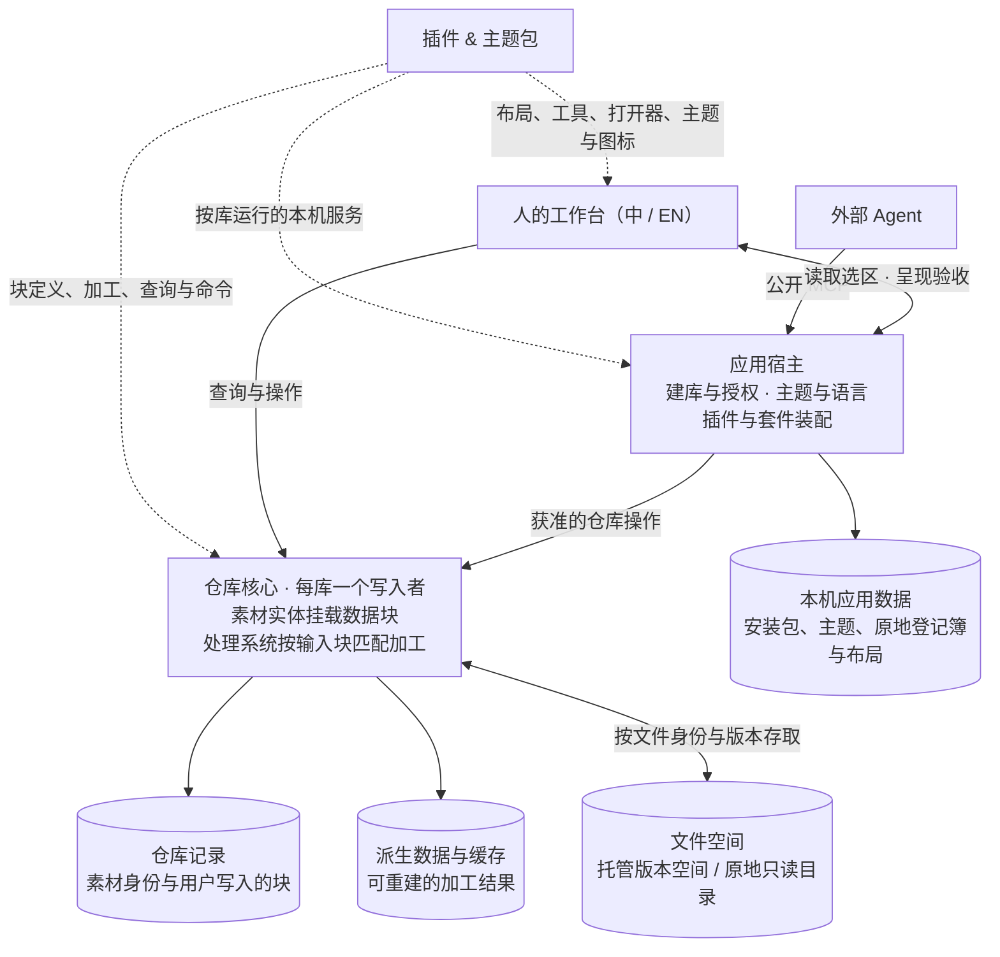

<div align="center">

<picture>
  <source media="(prefers-color-scheme: dark)" srcset="docs/assets/huoye-lockup-dark.svg" />
  <source media="(prefers-color-scheme: light)" srcset="docs/assets/huoye-lockup-light.svg" />
  
</picture>

**功能皆可插拔、AI 原生协作的本地开放资源底座**

*An open, AI-native loose-leaf workbench for files, media, and knowledge.*

简体中文 | [English](README.en.md)

[](LICENSE)
[](#快速开始)
[](#快速开始)
[](#5-全仓中英双语与大库实测性能)

[快速开始](#快速开始) · [核心特性](#核心特性) · [AI 协作](#4-原生-ai-协作) · [文档与教学](#文档与教学) · [致谢](#致谢与协作说明)

</div>

---


## 为什么做「活页」

我一直对“通用性”很感兴趣，顺着这个念头，走进了文件与资料管理的领域。

平时我们常常需要装上好几款软件，分别管图片、看电子书、记笔记、理表格。用久了难免会好奇：这些形态各异的工具背后，是不是藏着某种共同的本质？如果顺着往下看，很多时候它们其实都围绕着同一件事——**在稳定的身份之上，一层层按需叠加的数据与视图**。

**活页（Huoye）** 就是围绕这个想法的一次尝试，希望能做一个**像活页环一样、可以自由抽插与组合的开放底座**：

- **原件与视角分开**：文件既可以托管在带完整历史版本的受管文件空间，也可以零复制直连你硬盘上已有的文件夹；而一个个仓库，只是你整理与观察这些数据的不同侧面。
- **形态由插件与主题生长**：数据结构、后台加工、浏览布局与视觉气质全部可扩展——停用或卸载插件不会抹去原始积累，每个仓库还能拥有独立的外观主题与壁纸氛围。
- **从一开始就邀请 AI 参与**：不是事后外挂一个聊天框，而是让外部 AI 通过公开协议与明确授权，拥有与人接近的操作能力，一起参与建库、整理与复核。

装上不同的插件、套件和主题，它可以是 Eagle 式的视觉素材库，也可以长成表格资料库、电子书架、暖纸书房，乃至属于你自己的本地 AI 知识工作台。

---

## 一底多形：现在能用来做什么？

同一套底座与本地数据，在不同仓库里可以按需装配出不同的使用方式（全部随附与可选插件均已支持中英双语）：

| 形态 | 当前状态 | 包含能力与体验 |
| --- | --- | --- |
| **视觉素材库** | 开箱自带方案 | 文件夹目录树、标签与分组、评分、画幅尺寸、自动色板与色系筛选、笔记、来源、瀑布流与分屏详情（推荐「银盐画册」主题） |
| **通用资料与表格库** | 开箱自带方案 | PDF / 文字 / 网页来源管理、摘录批注、自定义字段模板、表格行内编辑、受控外部文件编辑（推荐「紧凑资料台」主题） |
| **扩展形态（7 个可选包）** | 附带可选插件包 | EPUB 电子书阅读器（支持跟随主题排版）、音乐播放器、层级标签树、画廊、时间线、状态与看板，在设置中多选即装 |
| **零复制直连老文件夹** | v0.2 新增 | 从开始页直接选择硬盘上已有的照片、文档或素材文件夹建库，原件留在原处，改名移动自动接续身份 |
| **昼夜内置主题与一库一风** | v0.2 新增 | 4 套带实景预览的昼夜内置主题，另有 7 套经典色板 + `.hytheme` 外部主题包（壁纸与平铺纹理、四角自动避让贴纸、毛玻璃、32 个自定义 SVG 图标） |


---

## 核心特性

### 1. ECS 风格的开放底座与三层插件扩展

借鉴 ECS（实体-组件-系统）的职责划分：每份素材拥有独立于文件路径的稳定身份（Entity），标签、笔记、字段、色板等作为数据块（Component）按需挂载，加工流水线（System）在后台异步生成缩略图、色系等可重建的派生结果。

同一个插件可以同时扩展**仓库核心（数据与加工）**、**工作台界面（布局、工具、打开器、公共 `UI Kit` 与 `ui-locale-v1` 词典）**和**本机服务**；原始记录（`library.db`）与可重建派生缓存（`derived.db`）分开存放，停用插件后原始数据依然保留，并可借助定义快照完成基本读取。



### 2. 双模式文件空间：托管保险箱 & 零复制原地目录

仓库管理素材身份与业务标注，文件空间管理原件定位、内容版本与可用性。多个仓库可以关联同一空间，各库的标签与笔记彼此独立：

- **托管版本空间（v4 保险箱）**：不可变内容版本历史、多库共享与独立版本接纳、受控外部编辑（准备托管工作副本 → 保存 → 发布新版 → 本库接纳）、以及仓库回收 / 空间回收 / 系统废纸篓三层清晰分离。
- **原地目录空间（v0.2 新增 · 零复制只读）**：
  - 在开始页点击 **「从本地文件夹开始…」**，直接将硬盘上已有的照片、论文、电子书文件夹挂入活页，**零复制、零侵入**（登记簿存在本机应用数据目录，不往你的原文件夹写任何隐藏文件）；
  - 同卷改名或跨子目录移动自动接续文件身份，支持根目录重定位与断盘离线保护；支持 `lib://` 原地流式读取（PDF 与音视频原生拖动跳转）；
  - 外部程序保存后，双击素材可核对并接纳新版，原有标签与笔记保留。旧文件被覆盖后，活页仍保留其大小和内容摘要。需要能取回的历史版本时，先选择 **「转为托管副本」**，再编辑托管文件。
  - 支持从空间反查本库引用，并经完整磁盘核对与二次复核安全回收已确认缺失的主文件记录。

### 3. 可定制的视觉气质与 `.hytheme` 主题体系（v0.2 新增）

外观与业务数据彻底解耦，同一套功能在不同仓库里可以呈现完全不同的阅读感与氛围：

- **4 套实景昼夜内置主题 + 一库一风**：开箱内置 **活页 · 标准**（新装默认）、**银盐画册**（视觉素材库推荐，印刷样张 / 看样暗房与细黑框题签）、**青瓷书房**（竹影页边 + 宽行距衬线阅读）与 **紧凑资料台**（通用资料库推荐），全部原生支持跟随系统昼夜切换（另于「经典主题」折叠区保留 7 套经典色板兼容旧配置）；每个仓库可独立设定主题与壁纸，独立内容小窗自动同步。
- **`.hytheme` 声明式主题包（v1–v6）**：无需插件执行权限，支持**昼夜双分支（跟随系统明暗或按库固定）**、实景预览图、卡片与阅读页部位排版（Text / PDF / EPUB 统一版心与纸墨）、以及经主进程严格几何清洗的 **32 个公共 SVG 图标替换**。
- **壁纸、贴纸与毛玻璃构图**：支持本库自选图片或直接**右键库内任意图片设为壁纸**，支持铺满 / 平铺纹理（可调纹理宽度）与 9 宫格锚点；四角角落贴纸自动避让侧栏与工具栏，支持大小与不透明度实时预览；侧栏/工具条毛玻璃平滑流畅，素材卡片逐卡模糊作为独立性能开关按需开启。
- **三层清晰外观入口**：应用默认外观、本库独立外观、以及已启用插件贡献的「插件外观」（如 PDF 默认纸面），按意图归集不迷路。


<p align="center"><sub>内置四套昼夜主题 · 左上：活页 · 标准（昼） · 右上：银盐画册（夜） · 左下：紧凑资料台（夜） · 右下：青瓷书房（昼）</sub></p>


<p align="center"><sub>随附可安装 <code>.hytheme</code> 主题包 · 左：蓝晒（夜） · 右：银杏·秋光（昼）——均支持昼夜双模切换、氛围壁纸与阅读排版</sub></p>

### 4. 原生 AI 协作

活页内置应用级 **MCP（Model Context Protocol）** 入口，界面操作与外部 Agent 共用同一套业务命令与校验边界：

- **四档显式授权**：按仓库独立控制 `off / read / organize / admin`，默认关闭；永久清除原件等不可逆操作不向 MCP 开放。
- **覆盖从建库到同屏复核的协作深度（L0–L2）**：
  - **L0 托管建库**：在获准范围内按起始方案后台建库、装配插件、建立分类与视图、编排分屏并亮窗交付。
  - **L1 只读与整理**：读取本库 Schema、正文与最多 12 张编号拼版预览图，按规则导入或核对原地目录、等待后台加工完成并补全标签、评分与字段。
  - **L2 同屏协作与批次验收单**：读取当前工作台页面与选区，定位高亮整理结果，并生成**带修改前后对比、支持人工修正与单项撤回的持久验收单**。
- **AI 辅助插件开发**：支持按授权由编码 Agent 创建独立插件工程、构建并在测试库中闭环验证。


### 5. 全仓中英双语与大库实测性能

- **中英热切换（v0.2 新增）**：在设置中选择跟随系统、简体中文或 English，开始页、工作台、设置、原生菜单和独立小窗会即时切换。两套起始套件和 19 个发行插件（随附 12 个、可选 7 个）提供双语词典，用户命名的素材、标签和视图保留原文。
- **5 万 / 10 万项实测基线**（Apple M5 · 16 GiB · macOS · 本机磁盘 · 启用 20 个插件，独立哈希 PNG 存量库）：

| 操作场景 | 5 万项规模 | 10 万项规模 |
| --- | ---: | ---: |
| 启动到首屏缩略图可见 | 5.01 s | 7.83 s（复测中位数 7.13 s） |
| 空闲输入搜索到结果（含防抖） | 333 ms | 456 ms |
| 点击缩略图到显示详情 | 34 ms | 34 ms |
| 后台收录 50 张至缩略图与色板全部就绪 | 3.09 s | 4.93 s |
| 无变化增量扫描核对 | ~0.8 ms | ~0.8 ms |
| 密集瀑布流（120 px 卡片）工作台毛玻璃滚动绘制中位数 / 掉块帧 | 0.14 ms / 0.0% | 0.13 ms / 0.0% |

> 完整取样口径、逐卡毛玻璃对照数据与复测命令见 [大库性能基线](host/docs/development/performance/README.md) 与 [瀑布流卡片毛玻璃实测](host/docs/development/performance/2026-11-21/卡片毛玻璃.md)。

---

## 快速开始

### 方式一：直接下载体验（推荐）

本版 macOS 包适用于 Apple Silicon。可在 [GitHub Releases](https://github.com/XinXingNOVA/huoye/releases) 下载，Windows 安装包将在实机验收后提供。

1. **主程序（开箱即用，无需手动装插件）**：
   - 打开 [DMG 安装包](https://github.com/XinXingNOVA/huoye/releases/download/v0.2.0/Huoye-0.2.0-mac-arm64.dmg) 将活页拖入「应用程序」，或解压 [macOS 应用 ZIP](https://github.com/XinXingNOVA/huoye/releases/download/v0.2.0/Huoye-0.2.0-mac-arm64.zip) 得到同一份应用。可用发行页的 [SHA256SUMS.txt](https://github.com/XinXingNOVA/huoye/releases/download/v0.2.0/SHA256SUMS.txt) 核对文件。
   - 启动后可直接 **「新建仓库」**（选择「视觉素材库」「通用资料与表格库」或「空白底座」），或点击 **「从本地文件夹开始…」** 零复制挂载现有文件夹。
2. **可选插件合集**：
   - 合集名为 [Huoye-0.2.0-plugins.zip](https://github.com/XinXingNOVA/huoye/releases/download/v0.2.0/Huoye-0.2.0-plugins.zip)，用于单独安装 EPUB 阅读器、音乐播放器、层级标签、画廊、时间线、状态和看板。
   - 解压后进入 **「设置 → 套件与插件包 → 安装套件或插件包…」**（支持多选）直接安装，再到目标仓库的 **「功能与方案 → 启停功能」** 按需开启。
3. **官方随附主题包（`.hytheme`）**：
   - 源码目录 `host/examples/themes/` 随附 2 套精选昼夜 `.hytheme` 主题包：**[cyanotype.hytheme](https://raw.githubusercontent.com/XinXingNOVA/huoye/v0.2.0/host/examples/themes/cyanotype.hytheme)（蓝晒）** 与 **[ginkgo.hytheme](https://raw.githubusercontent.com/XinXingNOVA/huoye/v0.2.0/host/examples/themes/ginkgo.hytheme)（银杏·秋光）**。进入 **「设置 → 外观与主题 → 安装主题包…」** 选择文件，再点「已安装主题」中的主题卡片即可使用。

> **macOS 首次打开提示**：当前作为个人开源项目暂未配置 Apple 开发者公证证书，从可信发行来源下载并核对校验和后，如果系统因隔离属性阻止打开，可在终端执行：
> ```bash
> xattr -dr com.apple.quarantine "/Applications/活页Huoye.app"
> ```

### 方式二：从源码构建运行

以下命令从源码根目录执行，适用于本仓库检出目录或解压后的源码快照。可下载 [Huoye-0.2.0-source.zip](https://github.com/XinXingNOVA/huoye/releases/download/v0.2.0/Huoye-0.2.0-source.zip)。需要 **Node.js 24+**、npm 及本机原生模块构建环境。

```bash
cd host
npm ci
npm run build
npm start
```

开发与预览默认使用独立的用户数据目录，不会影响正式使用的数据。更多插件打包与套件构建方式见 [开发与验证](host/docs/development/开发与验证.md)。

Windows 构建请从干净的源码目录开始，按 [Windows 构建指南](host/docs/development/Windows-AI构建指南.md) 安装依赖、打包和运行冒烟测试。安装器仍需在 Windows 本机验收。

---

## 文档与教学

- **快速上手**
  - [5 分钟上手活页](docs/guide/quick-start.md)：建库、零复制关联本地文件夹、导入整理、多形态分屏、撤销与原件取回
  - [外观、主题与壁纸定制指南](docs/guide/themes-and-appearance.md)：一库一风、昼夜跟随系统、壁纸/贴纸/毛玻璃调校与 `.hytheme` 主题包
  - [接上你的 AI 搭档（MCP 实战指南）](docs/guide/ai-mcp.md)：接入 Claude / Codex / Cursor、权限分级、原地目录整理与 L0–L2 示范 Prompt
  - [插件、套件与一软多库玩法](docs/guide/plugins-and-suites.md)：安装可选插件、按库组合能力、停用与数据清理
  - [平台说明与备份建议](docs/guide/platform-notes.md)：macOS / Windows 注意事项、FFmpeg 与数据备份
- **架构与设计**
  - [设计理念](host/docs/architecture/设计理念.md) · [系统架构](host/docs/architecture/设计文档.md) · [5 万 / 10 万项性能基线](host/docs/development/performance/README.md)
- **插件、主题开发与 AI 索引**
  - [10 分钟写出第一个活页插件](docs/developer/first-plugin.md)（含 AI 自主开发插件流程）
  - [公共 API 总览](host/docs/plugins/公共API总览.md) · [插件 UI Kit 速查](host/docs/plugins/UI-Kit.md) · [`.hytheme` 主题包规范](host/examples/themes/README.md) · [AI 文档索引（llms.txt）](llms.txt)

---

## 当前边界与后续计划

v0.2 已完成主题生态、原地文件空间与全仓中英双语三大底座升级，当前仍保留以下明确边界：

- **本地优先，暂无云同步**：数据全部保存在本机，备份时需同时保留仓库目录、关联的文件空间及本机原地登记簿（原地原件保留在你的原目录中）。
- **可信本地插件体系**：`.hytheme` 主题包为纯声明式零执行权限，但 `.hyplugin` / `.hysuite` 当前不做恶意代码沙箱，请只安装信任来源的插件包。
- **暂无在线商店与自动更新**：当前通过 GitHub Releases 分发应用、插件与源码包。

**接下来计划推进：**
- [x] 持续打磨界面视觉、昼夜跟随系统与 `.hytheme` 社区主题体系
- [x] 优化公共 UI Kit 组件套件，降低编写界面插件的门槛
- [x] 支持零复制原地目录文件空间，提供更轻快的日常使用体验
- [x] 完成宿主与全部官方插件的中英双语热切换适配
- [ ] 适配并回归阅读内嵌 AI 对话等实验插件，以套件为单位打造“电子书架 + 本地知识库 / 音乐专注空间”等更多开箱套件
- [ ] 补齐 Windows 实机全链路与更多媒体类型的测试覆盖
- [ ] 丰富插件与主题创作模板、探索更多语言扩展与社区文档

---

## 开源协议与品牌说明

- 本项目源码基于 [Apache License 2.0](LICENSE) 开源。
- 第三方依赖许可、原生组件源码索引及媒体依赖说明，请见 [THIRD-PARTY-NOTICES.md](THIRD-PARTY-NOTICES.md)。
- **品牌声明**：代码按 Apache-2.0 协议开放使用与修改，但「活页 / Huoye」名称与 Logo 归本项目作者所有；二次分发衍生版本时请使用独立的名称与图标。

---

## 致谢与协作说明

这个项目是我在大四期间用了一个多月时间，在与 AI 深度协作中慢慢打磨出来的一次探索。

- **特别感谢**：衷心感谢好兄弟 **[Zhangjingzhi](https://github.com/zhangjingzhi623)** 慷慨提供的 AI 会员支持，让这些想法得以顺利落地。
- **人机协作分工**：
  - **产品方向、核心架构与体验决策**：我本人
  - **方案设计与实现规划**：我本人 · Gemini · GPT
  - **代码编写与迭代重构**：GPT
  - **Logo、视觉与主题创作**：我本人 · Gemini · Claude

如果你也对开放式的本地资源管理、自定义主题，或者与 AI 共同协作的工作台感兴趣，欢迎随时提 Issue 聊想法，也欢迎试着给活页写一个属于你自己的插件或主题包。
