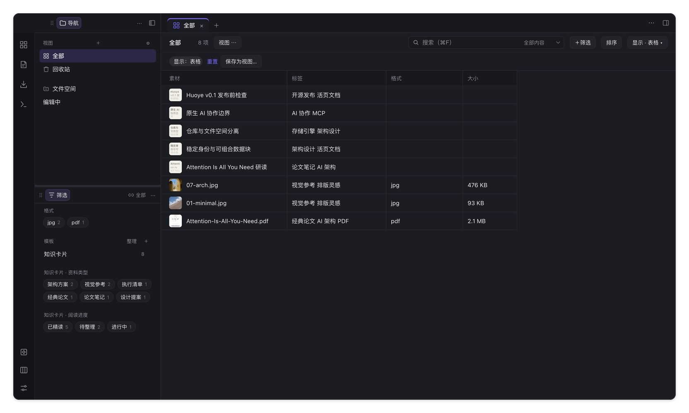
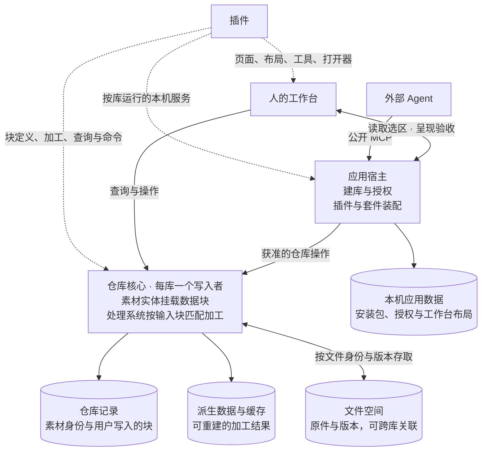
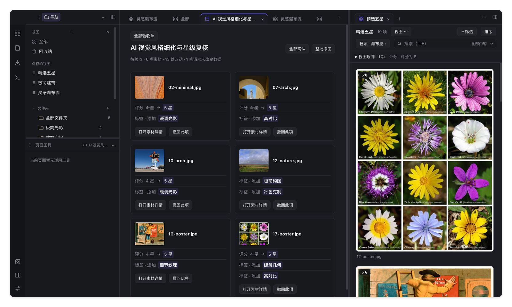

<div align="center">

<picture>
  <source media="(prefers-color-scheme: dark)" srcset="docs/assets/huoye-lockup-dark.svg" />
  <source media="(prefers-color-scheme: light)" srcset="docs/assets/huoye-lockup-light.svg" />
  
</picture>

**功能皆可插拔、AI 原生协作的本地开放资源底座**

*An open, AI-native loose-leaf workbench for files, media, and knowledge.*

[](LICENSE)
[](#快速开始)
[](#快速开始)

[快速开始](#快速开始) · [核心特性](#核心特性) · [AI 协作](#3-原生-ai-协作) · [文档与教学](#文档与教学) · [致谢](#致谢与协作说明)

</div>

---


## 为什么做「活页」

我一直对“通用性”很感兴趣，顺着这个念头，走进了文件与资料管理的领域。

平时我们常常需要装上好几款软件，分别管图片、看电子书、记笔记、理表格。用久了难免会好奇：这些形态各异的工具背后，是不是藏着某种共同的本质？如果顺着往下看，很多时候它们其实都围绕着同一件事——**在稳定的身份之上，一层层按需叠加的数据与视图**。

**活页（Huoye）** 就是围绕这个想法的一次尝试，希望能做一个**像活页环一样、可以自由抽插与组合的开放底座**：

- **原件与视角分开**：文件托管在文件空间里，获得不随路径改变的稳定身份；而一个个仓库，只是你整理与观察这些数据的不同侧面。
- **形态由插件生长**：数据结构、后台加工、浏览与使用方式都交给可扩展的插件，按需装卸，停用或卸载插件也不会抹去你的原始积累。
- **从一开始就邀请 AI 参与**：不是事后外挂一个聊天框，而是让外部 AI 通过公开协议与明确授权，拥有与人接近的操作能力，一起参与建库、整理与复核。

装上不同的插件和套件，它可以是 Eagle 式的视觉素材库，也可以长成表格资料库、电子书架、阅读器，乃至属于你自己的本地 AI 知识工作台。

---

## 一底多形：首版能用来做什么？

同一套底座与本地数据，在不同仓库里可以按需装配出不同的使用方式：

| 形态 | 首版状态 | 包含能力与体验 |
| --- | --- | --- |
| **视觉素材库** | 开箱自带方案 | 文件夹目录树、标签与分组、评分、画幅尺寸、自动色板与色系筛选、笔记、来源、瀑布流与分屏详情 |
| **通用资料与表格库** | 开箱自带方案 | PDF / 文字 / 网页来源管理、摘录批注、自定义字段模板、表格行内编辑、受控外部文件编辑 |
| **扩展形态（7 个可选包）** | 附带可选插件包 | EPUB 电子书阅读器、音乐播放器、层级标签树、画廊、时间线、状态与看板，在设置中多选即装 |
| **更多可能** | 持续生长中 | 阅读伴随 AI 对话、更丰富的书架与本地知识库套件——也欢迎一起通过插件探索 |



---

## 核心特性

### 1. ECS 风格的开放底座与三层插件扩展

借鉴 ECS（实体-组件-系统）的职责划分：每份素材拥有独立于文件路径的稳定身份（Entity），标签、笔记、字段、色板等作为数据块（Component）按需挂载，加工流水线（System）在后台异步生成缩略图、色系等可重建的派生结果。

同一个插件可以同时扩展**仓库核心（数据与加工）**、**工作台界面（布局、工具、打开器）**和**本机服务**；原始记录（`library.db`）与可重建派生缓存（`derived.db`）分开存放，停用插件后原始数据依然保留，并可借助定义快照完成基本读取。



### 2. 仓库与文件空间解耦

- **多库共享原件**：仓库管理素材身份与业务标注，文件空间（v4）管理原件、内容版本与可用性。多个仓库可以关联同一文件空间，各库的标签与笔记彼此独立。
- **受控文件编辑与分层回收**：调用外部程序编辑原件会通过托管工作副本完成（准备 → 保存 → 发布新版本 → 本库接纳），避免直接改坏历史原件；仓库回收、空间回收与系统废纸篓彼此清晰分层。
- **灵活工作台**：支持递归分屏、智能上下文工具组、独立内容小窗、同一查询的多视图切换，以及可复用的布局预设与 `.hysuite` 套件。

### 3. 原生 AI 协作

活页内置应用级 **MCP（Model Context Protocol）** 入口，界面操作与外部 Agent 共用同一套业务命令与校验边界：

- **四档显式授权**：按仓库独立控制 `off / read / organize / admin`，默认关闭；永久清除原件等不可逆操作不向 MCP 开放。
- **覆盖多种协作深度（L0–L2）**：
  - **L1 只读与整理**：读取本库 Schema、正文与拼版预览图，按规则导入、等待后台加工完成并补全标签、评分与字段。
  - **L0 托管建库**：在获准范围内按起始方案后台建库、装配插件、建立分类与视图、编排分屏并亮窗交付。
  - **L2 同屏协作与批次验收单**：读取当前工作台页面与选区，定位高亮整理结果，并生成**带修改前后对比、支持人工修正与单项撤回的持久验收单**。
- **AI 辅助插件开发**：支持按授权由编码 Agent 创建独立插件工程、构建并在测试库中闭环验证。



### 4. 大库实测性能参考

以下数据来自真实 Electron 窗口日用流程的实测记录（Apple M5 · 16 GiB · macOS · 本机磁盘 · 启用 20 个插件，样本为独立哈希 PNG 存量库）：

| 操作场景 | 5 万项规模 | 10 万项规模 |
| --- | ---: | ---: |
| 启动到首屏缩略图可见 | 5.01 s | 7.83 s（复测中位数 7.13 s） |
| 空闲输入搜索到结果（含防抖） | 333 ms | 456 ms |
| 点击缩略图到显示详情 | 34 ms | 34 ms |
| 后台收录 50 张至缩略图与色板全部就绪 | 3.09 s | 4.93 s |
| 无变化增量扫描核对 | ~0.8 ms | ~0.8 ms |

> 完整取样口径、原始数据与适用边界见 [大库性能基线](host/docs/development/performance/README.md)。

---

## 快速开始

### 方式一：直接下载体验（推荐）

当前预览版提供 macOS Apple Silicon 安装包，可从 [GitHub Releases](https://github.com/XinXingNOVA/huoye/releases/tag/v0.1.0) 下载。Windows 正在验证，安装包将在完成验收后提供。

1. **主程序（开箱即用，无需手动装插件）**：
   - macOS：[Huoye-0.1.0-mac-arm64.dmg](https://github.com/XinXingNOVA/huoye/releases/download/v0.1.0/Huoye-0.1.0-mac-arm64.dmg)
   - 启动后即可在开始页直接选择 **「视觉素材库」**、**「通用资料与表格库」** 或 **「空白底座」** 创建你的第一个仓库。
2. **[可选插件合集（Huoye-0.1.0-plugins.zip）](https://github.com/XinXingNOVA/huoye/releases/download/v0.1.0/Huoye-0.1.0-plugins.zip)**：
   - 包含 EPUB 阅读器、音乐播放器、层级标签、画廊、时间线、状态、看板共 7 个已打包好的 `.hyplugin` 文件（附 `插件说明.md`）。
   - 解压后在应用内进入 **「设置 → 套件与插件包 → 安装套件或插件包…」**（支持多选）直接安装，再到仓库的 **「功能与方案 → 启停功能」** 按需开启。

> **macOS 首次打开提示**：首版暂未配置 Apple 开发者签名证书，从可信发行来源下载并核对校验和后，如果系统因隔离属性阻止打开，可在终端执行：
> ```bash
> xattr -dr com.apple.quarantine "/Applications/活页Huoye.app"
> ```

### 方式二：从源码构建运行

下载并解压 [Huoye-0.1.0-source.zip](https://github.com/XinXingNOVA/huoye/releases/download/v0.1.0/Huoye-0.1.0-source.zip)。需要 **Node.js 24+**、npm 及本机原生模块构建环境（继续开发或重新提取源码时需要 Git）：

```bash
unzip Huoye-0.1.0-source.zip
cd huoye/host
npm ci
npm run build
npm start
```

开发与预览默认使用独立的用户数据目录，不会影响正式使用的数据。更多插件打包与套件构建方式见 [开发与验证](host/docs/development/开发与验证.md)。

Windows 构建和试用请使用全新解压的源码包，按 [Windows 构建指南](host/docs/development/Windows-AI构建指南.md) 执行；入口会完成依赖安装、打包和应用冒烟测试，安装器仍需在 Windows 本机人工验收。

---

## 文档与教学

- **快速上手**
  - [5 分钟上手活页](docs/guide/quick-start.md)：建库、导入整理、多形态分屏、撤销与原件取回
  - [接上你的 AI 搭档（MCP 实战指南）](docs/guide/ai-mcp.md)：接入 Claude / Codex / Cursor、权限分级与 L0–L2 示范 Prompt
  - [插件、套件与一软多库玩法](docs/guide/plugins-and-suites.md)：安装可选插件、按库组合能力、停用与数据清理
  - [平台说明与备份建议](docs/guide/platform-notes.md)：macOS / Windows 注意事项、FFmpeg 与数据备份
- **架构与设计**
  - [设计理念](host/docs/architecture/设计理念.md) · [系统架构](host/docs/architecture/设计文档.md) · [5 万 / 10 万项性能基线](host/docs/development/performance/README.md)
- **插件开发与 AI 索引**
  - [10 分钟写出第一个活页插件](docs/developer/first-plugin.md)（含 AI 自主开发插件流程）
  - [公共 API 总览](host/docs/plugins/公共API总览.md) · [示例工程](host/examples/) · [AI 文档索引（llms.txt）](llms.txt)

---

## 当前边界与后续计划

v0.1 是活页的第一个公开版本，核心底座与视觉样板已经跑通，但仍有一些明确的边界：

- **本地优先，暂无云同步**：数据全部保存在本机，备份时需同时保留仓库目录与关联的文件空间。
- **可信本地插件体系**：当前不做恶意代码安全沙箱，请只安装信任来源的 `.hyplugin` / `.hysuite`。
- **界面与部分实验插件仍在演进**：视觉配色与交互细节会继续打磨；阅读内嵌 AI 对话、番茄钟等早期实验插件会在适配新版工作台契约后陆续回归。
- **暂无在线插件市场与自动更新**：首版通过 GitHub Releases 分发应用与插件包。

**接下来计划慢慢推进：**
- [ ] 持续打磨界面视觉与浅色 / 深色主题体验
- [ ] 优化公共 UI 组件套件，降低编写界面插件的门槛
- [ ] 探索更多文件空间创建方式，提供更快捷的日常使用体验
- [ ] 适配并回归阅读内嵌 AI 对话等实验插件，沉淀“电子书架 + 本地知识库”开箱套件
- [ ] 补齐 Windows 实机全链路与更多媒体类型的测试覆盖
- [ ] 丰富插件开发模板与社区文档

---

## 开源协议与品牌说明

- 本项目源码基于 [Apache License 2.0](LICENSE) 开源。
- 第三方依赖许可、原生组件源码索引及媒体依赖说明，请见 [THIRD-PARTY-NOTICES.md](THIRD-PARTY-NOTICES.md)。
- **品牌声明**：代码按 Apache-2.0 协议开放使用与修改，但「活页 / Huoye」名称与 Logo 归本项目作者所有；二次分发衍生版本时请使用独立的名称与图标。

---

## 致谢与协作说明

这个项目是我在大四期间用了一个多月时间，在与 AI 深度协作中慢慢打磨出来的一次探索。

- **特别感谢**：衷心感谢好兄弟 **[Zhangjingzhi](https://github.com/zhangjingzhi623)** 慷慨提供的 AI 会员支持，让这些想法得以顺利落地。
- **人机协作分工**：
  - **产品方向、核心架构与体验决策**：我本人
  - **方案设计与实现规划**：我本人 · Gemini · GPT
  - **代码编写与迭代重构**：GPT
  - **Logo 与视觉探索**：我本人 · Gemini

如果你也对开放式的本地资源管理，或者与 AI 共同协作的工作台感兴趣，欢迎随时提 Issue 聊想法，也欢迎试着给活页写一个属于你自己的插件。
