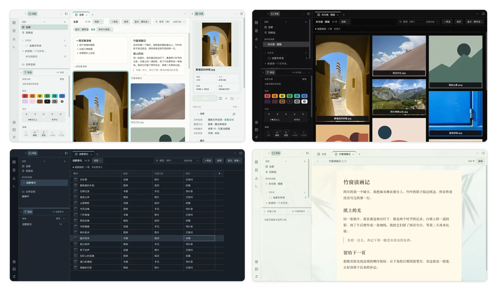
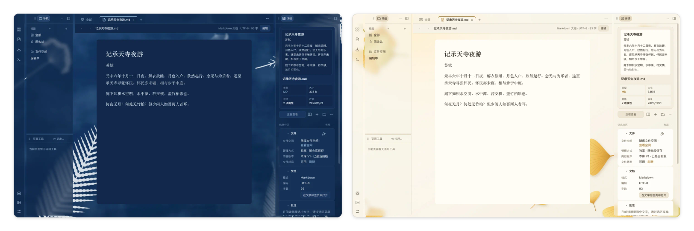

# 打造专属工作台：外观、主题、壁纸与 `.hytheme` 主题包

在活页里，**外观表现与仓库数据完全解耦**。你可以让图库走深邃暗色画廊、让论文书房用青瓷暖纸配衬线字、让音乐收藏室配上二次元立绘和毛玻璃——切换主题不会动你的一条标签、笔记或选区，拖出的独立内容小窗也会自动保持一致。

---

## 一、三层清晰的外观入口

打开设置（`Cmd + ,` / `Ctrl + ,`），外观相关选项按使用意图收纳在三处，不用来回猜测某个开关归谁：

1. **应用设置 → 外观与主题（全局默认 & 主题包仓库）**
   - 决定 **开始页** 和所有「跟随应用默认外观」的仓库使用什么主题、强调色、界面密度与圆角；
   - 统一负责本机 `.hytheme` 主题包的**安装与移除**。
2. **当前仓库 → 本库外观（一库一风）**
   - 默认跟随应用外观；点击 **「单独设置」** 后，当前仓库及其拖出的内容小窗就拥有独立外观（保存在本机，不影响仓库数据库）；
   - 本库专属的 **壁纸、角落贴纸与毛玻璃** 都在这里调节；随时可一键「恢复跟随应用」。
3. **当前仓库 → 本库外观 → 插件外观**
   - 如果当前仓库启用了提供视觉偏好的插件（例如内置 **PDF 阅读器 → 默认纸面**），它们的选项会自动聚合在本库外观下方，即使本库保持“跟随应用默认外观”也能直接调整。

> 套装方案也可以附带推荐主题：使用含推荐外观的 `.hysuite` 套件建库时会自动采纳；之后你手动改过的本库外观优先，套件更新不会覆盖你的选择。

---

## 二、4 套昼夜内置主题与经典色板

活页 v0.2.0 内置了 **4 套带实景预览、原生支持昼夜双模的主推主题**：

| 主题 | 气质与亮点 | 适用场景 |
| --- | --- | --- |
| **活页 · 标准** | 纸白（昼）与石墨灰（夜），活页青绿克制标出选中态与主操作 | **新装默认**，适合日常收集与混合素材库 |
| **银盐画册** | 浅色像印刷样张、深色像暗房看样；细黑框、印刷感黑白图标、平铺底纹与封面题签 | **视觉素材库推荐**，适合摄影、插画与作品集 |
| **青瓷书房** | 柔和竹影落在侧栏与页边，正文落在干净的暖纸/暗纸上，配宽行距衬线字 | 长文、Markdown、PDF 与 EPUB 沉浸阅读 |
| **紧凑资料台** | 紧凑行距、细分隔线与清晰蓝色焦点，检查器分区一目了然 | **通用资料与表格库推荐**，适合逐行核对字段 |

> 如果偏好 v0.1 时代的纯色基底（深邃曜石、冷灰石墨、松烟墨绿、暖日宣纸、晴空极简等 7 套），可在「内置主题」下方的 **「经典主题」** 折叠区中直接选用，老仓库配置与外部主题继承完全兼容。

任何内置主题都可以进一步微调：
- **强调色**：6 种预设或自定义取色；
- **界面密度**：**舒展** 或 **紧凑**（连表格等虚拟滚动行高也会同步变化，一屏多看几行且滚动定位不漂移）；
- **控件圆角**：利落 / 标准 / 柔和；
- **高级表面色彩微调**：按需细调外框壳层、侧栏、主画布、主文字与阅读纸张。

### 昼夜双分支主题（自动跟随系统明暗）
四套主推内置主题以及支持昼夜双分支的 `.hytheme` 主题包（`formatVersion: 6`，例如官方随附的 `cyanotype.hytheme`「蓝晒」与 `ginkgo.hytheme`「银杏·秋光」）都会在外观页自动显示 **「昼夜外观 · 明暗模式」**：
- **跟随系统**：随 macOS / Windows 的浅色与深色模式自动热切换（配色、壁纸、阅读纸墨甚至图标同步切换）；
- **固定浅色 / 固定深色**：按仓库锁定某一个分支（例如让论文库全天保持青瓷浅色，图库跟随系统）。

---

## 三、本库壁纸、角落贴纸与毛玻璃

开启 **「本库独立外观」** 后，可以在 **「工作台装饰」** 中为当前仓库定制氛围：

- **设置壁纸的两种方式**：
  1. 在「工作台装饰」点击 **「选择图片…」**（支持 20 MiB 以内的 PNG / JPEG / WebP，自动转存至本机托管目录，原图删掉也不影响）；
  2. **最顺手的方式**：在仓库画布里直接 **右键任意一张图片 →「设为本库壁纸」**（如果该素材被移入回收站，壁纸会自动隐藏；恢复素材后自动回来）。
- **壁纸构图调节**（拖动滑杆实时预览）：
  - **铺设方式**：`铺满`（适合风景、二次元插画）或 `平铺纹理`（可调 16–1024 px 纹理宽度，适合纸纹、格纹、点阵）；
  - **9 宫格锚点**：自由控制对齐左上、居中、右下等 9 个方向，防止人物裁切；
  - **氛围三项**：壁纸不透明度、亮度、模糊度。
- **角落贴纸**：
  - 选择透明底 PNG / WebP 作为角落立绘或徽章；
  - 支持 **四角位置任选**（自动避让左侧活动条/侧栏、右侧检查器与顶部工具栏，不遮挡操作、全程鼠标穿透不抢点击），并可实时调节 **贴纸大小（40%–200%）** 与 **不透明度**。
- **毛玻璃与性能开关**：
  - 支持调节 **表面不透明度** 与 **毛玻璃模糊**，作用于侧栏、工具条与浮层；
  - **素材卡片毛玻璃（默认关闭）**：默认只模糊工作台表面，卡片仍可透出壁纸。在 Apple M5 的 5 万与 10 万项密集图库测试中，仅工作台启用毛玻璃时，两档的呈现间隔 P95 均约为 16.7 ms，均未观察到未就绪图块。喜欢逐卡模糊的效果，可以在本库开启。[测试条件与逐帧数据](../../host/docs/development/performance/2026-11-21/卡片毛玻璃.md)

---

## 四、统一阅读排版（Text / PDF / EPUB）

活页的主题系统可以深入阅读区（`reader-page`）：
- 主题包可统一指定正文版心宽度、页边距、字号、行高、纸色、墨色、页外底色以及 PDF 护眼滤镜；
- **手动偏好始终优先**：你在 EPUB 阅读器里手动改过字号，或在 PDF 工具栏临时切过原色/暖纸/暗色，切换主题时不会被冲掉，随时可一键「恢复主题排版」或回到「跟随本库默认」。

---

## 五、安装与制作 `.hytheme` 主题包

`.hytheme` 是**纯声明式主题包**（单文件 JSON 或 ZIP，最大 8 MiB，**不含任何可执行代码**）：

1. **安装官方随附主题包试试手**：源码包 `host/examples/themes/` 随附 2 套精选昼夜双模 `.hytheme` 主题包：
   - **`cyanotype.hytheme`（蓝晒）**：氰版印相风格——白天是棉纸手工蓝刷边，入夜是普鲁士蓝全幅显影与白色蕨类剪影，配衬线正文与毛玻璃侧栏；
   - **`ginkgo.hytheme`（银杏·秋光）**：白天是宣纸疏落金叶，入夜是深靛夜空与路灯逆光银杏枝头，配右下角透明银杏叶贴纸与暖金阅读排版。

2. 在 **「设置 → 外观与主题 → 安装主题包…」** 选择 `.hytheme` 文件。回到 **「已安装主题」**，点击刚安装的主题卡片即可应用。只想给当前仓库使用时，在 **「本库外观 → 单独设置」** 选择这张卡片。要切回原先的内置主题，可点 **「还原内置外观」**。
3. **自己写或让 AI 帮你写主题包**：完整字段规范（v1–v6、32 个可替换 SVG 图标名、部位参数与打包校验规则）见 [`.hytheme` 主题包规范](../../host/examples/themes/README.md)。
