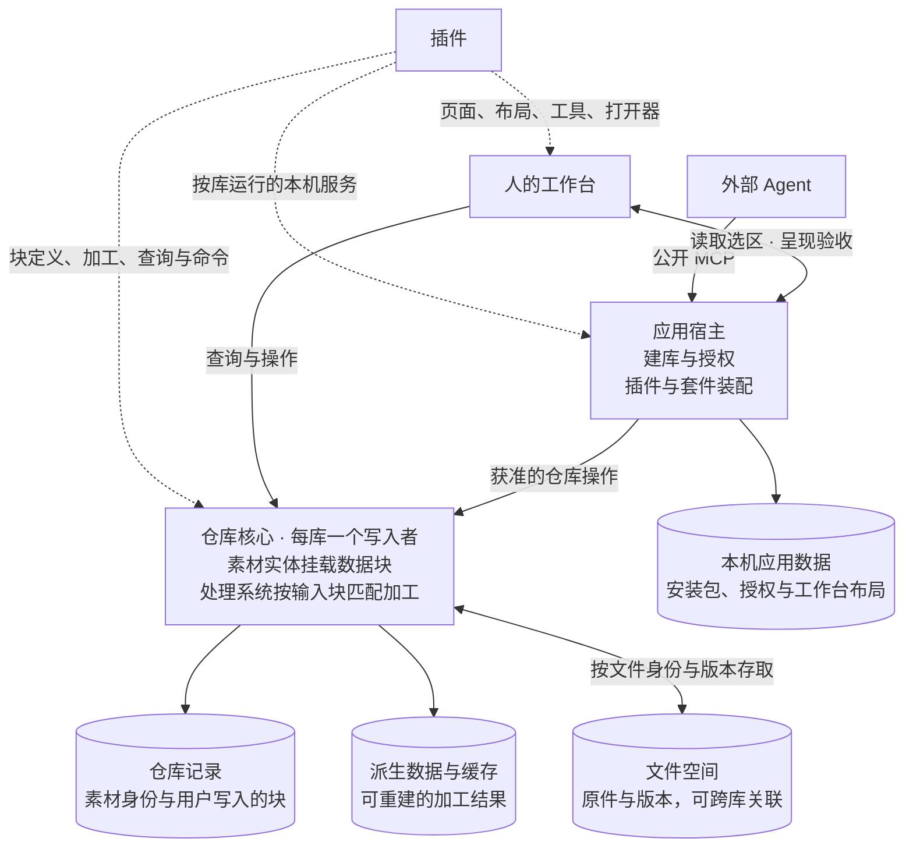

# 当前架构

## 功能架构图

每个库可以启用不同的插件。同一个插件可以扩展仓库的数据模型和行为，改变工作台的操作方式，也可以提供随库运行的本机服务。图中虚线表示插件向各层注册能力，实线表示调用或数据存取。

**一个插件可以同时改变三层。** 启用 AI 对话插件后，用户可以选中原文，点「向 AI 提问」，在工作台右侧看到逐段返回的回答。选区动作和侧栏由插件注册，本机服务负责请求模型，仓库里的对话块保存消息与原文引用。其他插件可以只实现其中一层。对外开放的业务查询和操作也由插件声明，Agent 通过 MCP 在本库授权范围内调用。[工作台注册表](../../src/renderer/src/ui-registry.ts) · [本机服务契约](../../src/plugin-api/local-service.ts) · [仓库插件契约](../../src/plugin-api/core/contracts.ts)

**ECS 在截图入库时怎样工作。** 收录后，每张截图有一个稳定的素材身份（Entity），文件版本引用、评分和标签都挂在这个身份上。数据块（Component）对应 World 框架里的 Support。启用色板插件后，它的处理系统（System）读取缩略图生成色板，下一个系统根据色板算出色系。之后工作台和获准的 Agent 都能按色系查到同一张截图。[导入与收录](../../src/core/ingest.ts) · [仓库加工调度](../../src/core/scheduler.ts) · [文件版本引用](../../src/storage/space-reference.ts)

**同一个“五星横图”视图有两种保存动作。** 保存视图会把查询条件和浏览布局（如表格）写进本库的 `view` 块；把它放到右侧分屏，则由本机按仓库身份保存工作台布局。界面编辑器和 MCP 的 `save_view` 共用同一个保存视图命令，更新时都会核对原块的序号。[界面编辑器](../../src/renderer/src/components/ViewEditor.tsx) · [保存视图命令](../../src/plugins/view/core.ts) · [工作台存储](../../src/main/workspace-storage.ts)

## 分层

| 层 | 拥有的职责 | 不应越界承担 |
| --- | --- | --- |
| 仓库核心 `src/core` | 身份、块定义、索引、事务／撤销、查询、收录、派生调度 | UI 状态、具体插件业务 |
| 文件空间 `src/storage` | 文件身份、版本字节、定位、成员权限、可用性与原件处置 | 素材标签、笔记等仓库业务 |
| 应用 `src/main` | 窗口、IPC、原生能力、插件安装、跨层流程与 MCP 授权 | 直接复刻核心写入逻辑 |
| 界面 `src/renderer` | 工作区、视图、交互状态、公共 UI 实现 | 绕过事务直接改文件或数据库 |
| 公共 API `src/plugin-api` | 后端、界面、服务的公开契约 | 引入业务插件私有实现 |
| 内部模块 `src/plugins` | 文件、视图及文字／媒体等保留内部的能力、应用 MCP | 依赖外部业务源码目录 |
| 外部插件 | 独立数据声明、业务命令／查询、UI 与服务 | 私有 Host、数据库连接、原生 bridge |

公共能力另按**应用宿主、工作台、仓库核心、文件空间**建立[API 职责索引](../plugins/公共API总览.md)。上表是代码与运行分层，索引是能力归属；工作台属于应用宿主，因页面与交互接口较多单列。`UiHost`、`CoreClient` 是组合门面，不以调用入口推定所有权。按本机仓库身份保存的布局、预设或草稿不等于仓库数据；导入、文件编辑与组合处置由应用协调，各层分别维护事实和恢复边界。当前保留原名称及导入路径，不因分类要求插件迁移。

仓库连接的接口声明在 `shared/api` 按 `LibraryApi`、`FileSpaceApi`、`FileWorkflowApi` 分开，`shared/rpc.ts` 组合为同一个 `CoreApi` 并保留事件、消息和既有导出。收录输入在 `shared/ingest-input.ts`，素材清理结果在 `shared/item-lifecycle.ts`，这些领域定义不依赖 RPC 门面。`plugin-api/core.ts` 继续提供异步 `CoreClient`；没有新增路由、权限、服务实例或外部 SDK 别名。UI 已独立的草稿／工作副本／预设契约继续由 `UiHost` 组合，业务实现不随声明分类迁移。

## 窗口运行与界面装配

2026-11-14：一个仓库会话仍只有一个核心进程和一份主工作台状态，允许附属显示窗口。`main/auxiliary-windows.ts` 统一登记拥有者、受控窗口种类、关闭请求、菜单及原生弹窗归属；`auxiliary-surface.tsx` 将所属窗口的 React 子树放入同源显示文档，并同步宿主／插件样式与主题。首个接入是设置，主窗口承担表单退出检查与仓库生命周期，附属窗口不建立第二份业务运行环境。见[设置接入](../plugins/设置与命令接入.md#原生设置窗口与插件适配2026-11-14)。普通内容组也已接入，同源显示文档只是原实例的另一个位置；不是多份独立 App。内容关闭沿用页面／工具规则，主会话继续协调全部窗口。

`src/renderer/src/App.tsx` 建立每个仓库窗口独有的共享编辑／选区服务，在顶层连接控制模块并组装画面。具体运行职责集中在 `src/renderer/src/app/`，属于宿主内部实现，不是新的插件 API；现有布局算法、页面实例规则、编辑会话与选区实现继续复用。

| 模块 | 拥有的内容 | 与其他层的协作 |
| --- | --- | --- |
| `workspace.ts` / `useWorkspace` | 工作区恢复与唯一状态、页面注册、活动页、保活、实例规则、分屏及侧栏动作 | 向画面提供快照，向其他模块提供只读页面访问与明确动作；结束使用交给生命周期模块 |
| `lifecycle.ts` / `usePageLifecycle` | 400ms 合并保存、检查点、页面结束、重载／退出准备及失败处理 | 读取当前工作区、导出／提交共享草稿、调用插件 `beforeLeave`；不直接修改布局 |
| `ui-host.ts` / `useUiHost` | 已有 `UiHost` 的实现、打开器与素材操作、页面宿主缓存 | 连接后端、工作区和浮层；页面上下文实时读取，异步打开和菜单动作保留发起时的位置 |
| `overlays.tsx` | 预览、附加、导出、删除确认、插件弹窗与通知的临时状态及呈现 | 复用原有组件；业务浮层仍在工作区 `inert` 范围内，插件结束交互与通知保持原来的外层位置 |
| `workspace-windows.ts` / `ContentWindows` | 原生窗口准备与普通组位置、小窗外壳及关闭请求 | 共用放置解析、实例身份和生命周期，不另建内容运行时 |
| `EditorSurfaces` / `RetainedSurface` / `display-windows.ts` | 唯一内容持有者、跨文档插槽安放及输入文档登记 | 容器只提供插槽；样式、焦点与公共浮层跟随显示文档 |
| `TabHost.tsx` | 页面组件的装载、焦点捕获及参数／状态投影 | 保留 memo、可见／活动状态和隐藏方式，不承担结束使用或保存 |
| `intake.ts` / `useIntake` | 目标规则读取、收录确认队列、预检／提交／准入流程、逐批结果 | 使用现有核心 API；返回状态与完成／关闭动作，由现有组件呈现 |
| `transfer.ts` / `useTransferInput` | 拖放／粘贴监听、DOM 目标与区域高亮、输入快照与解析 | 在异步读取／下载前捕获收录目标，再交给 `useIntake` |
| `commands.ts` / `useWindowCommands` | 键盘优先级、原生菜单路由、原生输入框编辑适配 | 调用工作区动作、浮层动作、共享编辑与核心命令，不复制业务实现 |
| `page-access.ts` / `PageAccess` | 宿主内部只读访问约定 | 工作区模块提供稳定对象，方法在调用时读取当前页面、焦点和页面能力；各模块用 `Pick` 限定所需能力 |

工作区没有新增状态副本。模块不接收可写工作区 ref 或任意 `setState`；操作通过明确回调完成。工作区更新仍先同步更新当前读口，再通知 React，保证同一次捕获事件里的插件调用能看到正确目标。装配保持访问对象、动作和页面宿主稳定，各监听按实际依赖订阅和释放，不能因为确认框或结果列表更新而中断正在解析的输入。收录模块卸载时释放尚未回答的确认等待，原有临时结果不变成持久任务日志。

生命周期调用需要对应页面的 `UiHost`，而宿主接口又要调用工作区动作。这个关系只在 `App` 用稳定的 `PageHosts` 读口接通：`forPage` 在回调执行时取得最新装配，`forget` 在页面关闭／替换提交后释放该页面的宿主缓存。模块不相互导入运行实例，不增加全局单例或事件总线；拿不到宿主不能被解释成保存成功。

结束顺序保持：失焦 → 保存本机检查点 → 调用页面 `beforeLeave` → 成功后提交页面变更。正常整窗退出／重载逐页准备后提交共享编辑，再保存检查点；后台已退出的恢复路径只保留本机快照。失败、取消和超时继续保留页面。隐藏、冻结或跨区移动不触发结束回调；实例数量、来源导航和保活规则不因拆分改变。

键盘继续按输入框、浮层、活动页、窗口的顺序处理。原生菜单单独保留共享编辑撤销、普通输入框编辑和仓库撤销的路由；它与 DOM 键盘并非完全相同的拦截规则。拖放／粘贴沿用输入发生时的目标快照；菜单导入仍保留发起时的标签页身份，在文件选择完成后读取其收录规则，不在本次拆分中改变行为。

这两批只迁移职责与状态所有权，不改变公共 `UiHost`、查询／准入协议、工作区存档或仓库格式。自定义 hook 拆分不等于隔离渲染，也不据此宣称性能提升；当前职责已经分开，后续由具体功能与使用问题推动。现行收录规则见[查询与视图](查询与视图.md)。

## 打开方式

打开器仍由插件按数据块匹配，宿主收集全部匹配项，按明确选择、本机默认偏好、自动优先级决定使用入口；位置、页面身份及生命周期独立处理。偏好属于本机仓库配置，不是素材数据。系统查看通过主进程核验并复制本库接纳版本，复制品与空间原件物理隔离；不扩展文件写入协议。接口、回退和副本保留规则见[打开方式](../plugins/打开方式.md)。

## 数据模型

身份与数据块分离。持久块保存在 library.db，可重建结果保存在 derived.db；kind_def 保存结构快照，使缺插件的数据仍可基本读取。管理记录与普通素材区分，模板、分组等不强行成为普通卡片。引用区分普通关联与依附生命周期。修改已用定义必须遵守兼容／迁移规则，保留来源与撤销关系。

## 运行与写入

每个打开的仓库由唯一核心进程写入。Host 负责组件装配与清理；BlockEditing 统一普通编辑约束，PluginCommands 提供命令／预演上下文，Admission 处理视图准入，Definitions 管定义接续，SpaceRefresh 处理可用性通知。Operations 提供校验、事务与 requestId 回执，业务只读查询提供有界数据读取。

普通写入必须有身份，不得手改派生块或替换文件引用。文件内容走异步编辑协议。命令、预演和外部操作复用约束；回滚同时处理数据、历史与回执。可信插件仍有运行环境能力，这些约束不是恶意代码沙箱。

会话操作历史与撤销共用 `History`：只在提交成功后通知，公开有界摘要和影响身份；请求来源随实际修改落库，回执重试不重复记录。UI 与 MCP 共享查询，撤销仍是当前核心会话的线性栈。成功开始新核心会话清理旧历史；本会话按最近 1000 笔与约 64 MiB 载荷保留完整操作，最新一笔不拆分。裁剪与新写入同事务，重放不追加无主快照；回执和任务独立保留。原件、应用配置和未保存草稿不并入该栈，永久清除会清理对应历史，见[操作历史](../plugins/操作历史.md)。

初始化失败停止已创建组件并关库；加工在装配成功后启动。当前关闭是同步停止／取消，并不承诺等待所有外部任务完成。

## 仓库结构准备与任务恢复

`openLibrary` 在核对身份、格式并取得仓库锁后，通过 `core/schema.ts` 的 `prepareLibrarySchema` 集中准备结构，随后创建／接续随库空间、绑定文件访问，最后由 Host 装配业务。导入映射、草稿、版本候选、扫描游标、编辑请求和空间关联的表与索引只在这里声明；`Ingesting`、`FileUpdates`、`FileEdits`、`SpaceBindings` 的构造不再建表。

保留现行仓库格式、表字段与文件空间 v4。历史 `block_history.op`／`new_data` 与 `operation.context / bytes` 增量分别检查、补齐，已有值保持；SQL 准备在事务内完成，运行时失败回滚本次修改并由打开入口释放连接和锁。`main` 与 `derived` 使用 WAL，此处不承诺断电时两个数据库跨文件原子提交；派生数据仍按可重建规则处理。

结构准备不恢复业务任务、不扫描空间、不发布文件，也不删除旧任务记录。导入重试、已发布编辑接纳、旧发布回执恢复仍由原业务流程驱动。随库空间的数据库和目录操作不并入仓库建表事务，继续通过 `managed_space_pending` 接续；关联的 pending／detaching 状态、导入草稿、接纳游标与请求回执均保留。准备结构与创建空间可能分别成功或失败，不能将它们描述为跨库原子操作。

## 扩展

插件按声明贡献块、加工、命令、只读查询、收录附加意图、视图、详情区和侧栏。公共选区是有作用域和生命周期的临时协作上下文。服务复用本机配置、凭据及取消流，不等于持久任务队列。公共能力从具体案例提炼，业务策略留在插件。

内部模块由目录声明生成装配。外部源码不在宿主工程，安装包与已应用开发快照经同一结构校验与运行装配。发行兼容元信息在 packaging/plugins；构建是否附带包单独选择。源码位置不会赋予发行或旧 ID 接管资格。

## 演进约束

保持数据身份和原件；性能优化以测量为依据。未知／休眠定义可基本读，专用编辑需对应插件。无任意外部目录引用、跨设备同步合并或公开市场保障；这些按具体场景继续探索。大库刷新是已有基准发现的待优化点。

## 文件操作入口与恢复边界

空间授权统一使用 setVersionPermission，明确 revise／recycle；仓库授权与 MCP 授权仍分层。文件编辑统一走 prepareFileEdit → commitFileEdit，取消和放弃分别用 cancelFileEdit／discardFileEdit；接纳已有空间版本仍使用 previewFileUpdate／acceptFileUpdate。旧 prepareFileReplacement、publishFileReplacement 及配套取消／放弃 RPC 已退役。

旧 space_publications 记录仅由 src/core/legacy-publications.ts 恢复适配读取。只有空间已有提交回执，才继续本库接纳；离线、回收或写入失败保留任务等待后续扫描，素材引用已另行变化则记录 skipped。无回执的旧草稿／意图不自动发布，记录和草稿不清除；需要继续编辑时使用现行编辑入口重新准备。新库不再创建旧表，既有库不删除表、回执或原件。存储审计仍报告未完成任务。

仓库彻底删除只报告身份、依附项、保留原件引用数和失败项，移除恒零的 files／bytes 与旧 retainedShared 字段；文件空间处置另走自己的预演和执行接口。应用启动仅按 LIBRARY_PATH 或上次打开列表恢复，不再探测固定 dev.library／文档目录中的旧默认库。

## 应用 MCP 配置提交

`application-state.json` 是授权、token、新建意图及回执的权威记录；`application.json` 是可重建的连接配置。设置、登记及创建记录都在内存副本上修改，先原子替换连接配置，再原子替换权威文件，成功后才切换运行状态和 endpoint。权威写入失败时保持旧内存状态并尝试还原连接配置，原操作仍报告失败；设置读取返回独立快照。

两个文件不构成跨文件原子事务。若中断发生在两次替换之间，或还原连接配置也失败，连接配置可能暂时过期；服务端始终依据权威授权检查请求，启动发布 endpoint 时重新生成连接配置。此方案不改变文件格式，不提供断电级落盘保证，也不将保存失败解释成一次成功授权。
